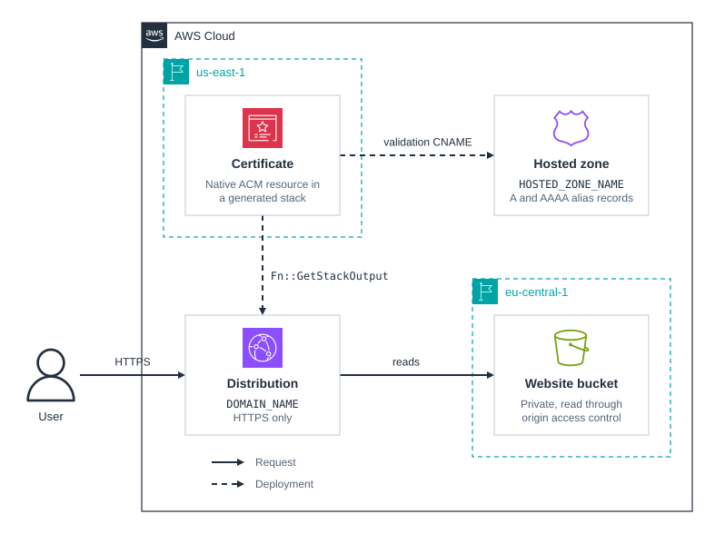

# cdk-acm-dns-validated-certificate

CDK app that serves a static website through CloudFront on your own domain, with a certificate from [`DnsValidatedCertificateV2`](https://github.com/open-constructs/aws-cdk-library) in the Open Constructs Library.

CloudFront only accepts ACM certificates from `us-east-1`, while this app's stack lives in `eu-central-1`. `DnsValidatedCertificateV2` handles that by creating a native `AWS::CertificateManager::Certificate` in a stack it generates in `us-east-1`, validating it with a CNAME in your Route 53 hosted zone, and reading its ARN back through `Fn::GetStackOutput`. No custom resource or Lambda function is involved.

## Prerequisites

- **_AWS:_**
  - Must have authenticated with [Default Credentials](https://docs.aws.amazon.com/cdk/v2/guide/cli.html#cli_auth) in your local environment. Synthesis looks up the hosted zone, so it needs credentials too.
  - Must have completed the [CDK bootstrapping](https://docs.aws.amazon.com/cdk/v2/guide/bootstrapping.html) for both `eu-central-1`, where the app is pinned, and `us-east-1`, where the certificate stack goes.
  - Must have a public Route 53 hosted zone for a domain you own, with the registrar delegating to its name servers, so ACM can validate the certificate.
  - Must have set these variables in your local environment:
    - `HOSTED_ZONE_NAME`: the hosted zone's domain, such as `example.com`.
    - `DOMAIN_NAME`: the domain the website is served on, such as `www.example.com`. It must be in that hosted zone and must not have an `A` or `AAAA` record yet.
- **_mise:_**
  - [Install mise](https://mise.jdx.dev/installing-mise.html), which manages the required toolchain.

## Installation

```sh
mise install
pnpm install
```

## Deployment

```sh
pnpm run deploy
```

This deploys `cdk-acm-dns-validated-certificate-dev-certificates-us-east-1` first and waits for ACM to issue the certificate, which took under three minutes in testing, then `cdk-acm-dns-validated-certificate-dev`.

## Usage

Open the `Url` output in a browser, or request it:

```sh
curl -I "https://$DOMAIN_NAME"
curl -I "http://$DOMAIN_NAME"
```

The first returns `200` and the second a `301` to HTTPS. To see the certificate CloudFront presents:

```sh
openssl s_client -connect "$DOMAIN_NAME:443" -servername "$DOMAIN_NAME" </dev/null 2>/dev/null \
  | openssl x509 -noout -subject -issuer
```

## Cleanup

```sh
pnpm destroy
```

This destroys the website stack, then the certificate stack, including the certificate, the distribution, the bucket with its objects, and the alias records. Two things remain until you delete them:

- The validation CNAME, `_<hash>.$DOMAIN_NAME`, stays in the hosted zone, because CloudFormation does not delete the records ACM validated with. ACM uses that one record for every certificate for the domain in your account, in any region, so delete it only when no other certificate covers the domain, or that certificate stops renewing.
- Lambda creates the bucket auto-delete function's log group outside the stack.

## Architecture Diagram



## Application Details

- Certificate
  - `certificateRegion: "us-east-1"` makes the construct create `<stack name>-certificates-us-east-1` for the certificate, with the account and tags of the stack that declares it. Pass `certificateStack` instead to own that stack's name, synthesizer, or termination protection.
  - The distribution reads the ARN through `Fn::GetStackOutput`, a weak reference, so CloudFormation does not stop you from deleting the certificate stack first. `pnpm destroy` deletes the stacks in the right order.
  - The certificate keeps the construct's defaults: RSA 2048, certificate transparency logging, not exportable, and deleted with its stack.
  - The certificate stack needs a concrete hosted zone ID, so the app looks the zone up with `HostedZone.fromLookup`. `cdk.context.json` is gitignored, so each synthesis queries Route 53 again.
- Website
  - The bucket is private, and CloudFront reads it through origin access control. `BucketDeployment` uploads [`index.html`](./src/website/index.html) and invalidates the distribution's cache.
  - The distribution redirects HTTP to HTTPS and serves HTTP/2 and HTTP/3. `A` and `AAAA` alias records point `DOMAIN_NAME` at it.

## Comparison

| Approach                                                | How the certificate reaches `us-east-1`                                               | Extra resources                                       |
| ------------------------------------------------------- | ------------------------------------------------------------------------------------- | ----------------------------------------------------- |
| `DnsValidatedCertificateV2` (this app)                  | A generated stack with a native ACM certificate, referenced with `Fn::GetStackOutput` | None                                                  |
| `DnsValidatedCertificate` in `aws-cdk-lib` (deprecated) | A custom resource requests and validates the certificate from the stack's own region  | A Lambda function and its role                        |
| `Certificate` in a `us-east-1` stack you write          | `crossRegionReferences: true` copies the ARN through SSM parameters                   | Custom resources with Lambda functions in both stacks |
