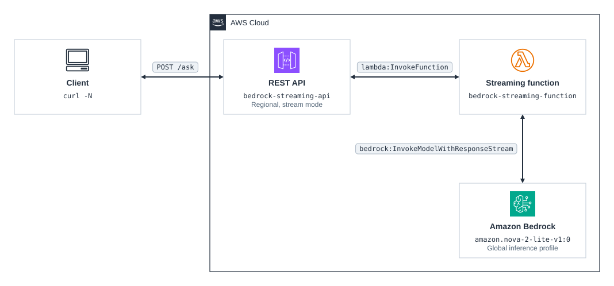

# cdk-apigw-bedrock-streaming

CDK app that deploys a REST API with [response streaming](https://docs.aws.amazon.com/apigateway/latest/developerguide/response-transfer-mode.html), backed by a Lambda function that streams an Amazon Bedrock answer back as the model writes it.

## Prerequisites

- **_AWS:_**
  - Must have authenticated with [Default Credentials](https://docs.aws.amazon.com/cdk/v2/guide/cli.html#cli_auth) in your local environment.
  - Must have completed the [CDK bootstrapping](https://docs.aws.amazon.com/cdk/v2/guide/bootstrapping.html) for the target AWS environment.
  - The target Region must offer the [global inference profile](https://docs.aws.amazon.com/bedrock/latest/userguide/model-card-amazon-nova-2-lite.html) for Amazon Nova 2 Lite.
- **_mise:_**
  - [Install mise](https://mise.jdx.dev/installing-mise.html), which manages the required toolchain.

## Installation

```sh
mise install
pnpm install
```

## Deployment

```sh
pnpm run deploy
```

## Usage

Post a message to the `BedrockStreamingApiUrl` output; `-N` turns off curl's buffering so the answer prints as it arrives:

```sh
curl -N -X POST <BedrockStreamingApiUrl> \
  -H 'Content-Type: application/json' \
  -d '{"message": "Write a 300-word story about a lighthouse."}'
```

The headers and first words arrive in under a second, and the rest follows in chunks until the model finishes. A body without a non-empty `message`, or with any other field, returns `400`.

## Cleanup

```sh
pnpm destroy
```

This removes every stack resource, including the function's log group.

## Architecture Diagram



## Application Details

- `bedrock-streaming-api`
  - A Regional REST API whose `POST /ask` method uses a Lambda proxy integration with the `STREAM` response transfer mode, so API Gateway calls the function with `InvokeWithResponseStream` and forwards each chunk as it arrives.
  - Regional because a stream closes after 5 minutes without data there, against 30 seconds on an edge-optimized endpoint.
  - The integration timeout and the function timeout are both 15 minutes, the longest API Gateway streams a response; a buffered response is limited to 29 seconds.
  - The stage throttles requests to 5 per second with a burst of 10, since the API is public and every request spends Bedrock tokens.
- `bedrock-streaming-function`
  - The [handler](./src/functions/bedrock-streaming/index.ts) validates the body with Zod, then calls `ConverseStream` on the `global.amazon.nova-2-lite-v1:0` inference profile.
  - It sends the status only after Bedrock accepts the request, so a throttled or failed call returns `429` or `502` instead of a `200` with a broken body.
  - `awslambda.HttpResponseStream.from` writes the status, the headers, and the 8-byte delimiter that API Gateway expects before the payload, and `pipeline()` writes each text delta to the stream.
  - The role may call `bedrock:InvokeModelWithResponseStream` only on that inference profile and on the Nova 2 Lite model it routes to, following the [global cross-Region inference policy](https://docs.aws.amazon.com/bedrock/latest/userguide/global-cross-region-inference.html).
