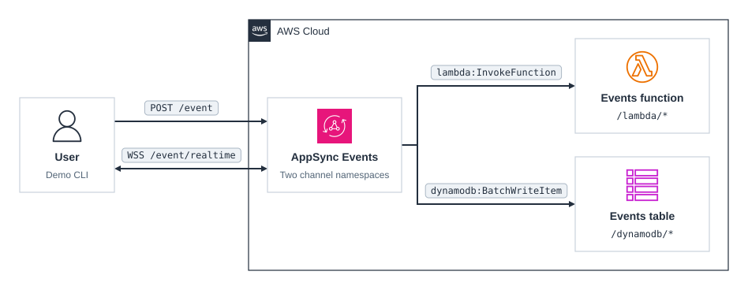

# cdk-appsync-events

CDK app that deploys an AppSync Events API with one channel namespace backed by a Lambda function and another by a DynamoDB table.

### Related Apps

- [cdk/detect-labels](../../cdk/detect-labels) - Uses AppSync Events to push results to a browser, with no data sources.

## Prerequisites

- **_AWS:_**
  - Must have authenticated with [Default Credentials](https://docs.aws.amazon.com/cdk/v2/guide/cli.html#cli_auth) in your local environment.
  - Must have completed the [CDK bootstrapping](https://docs.aws.amazon.com/cdk/v2/guide/bootstrapping.html) for the target AWS environment.
- **_mise:_**
  - [Install mise](https://mise.jdx.dev/installing-mise.html), which manages the required toolchain.

## Installation

```sh
mise install
pnpm install
```

## Deployment

```sh
pnpm run deploy
```

## Usage

```sh
pnpm -C src/demo/cli start
```

The demo finds the API with your default AWS credentials, subscribes to both namespaces over WebSocket, and publishes one event to each over HTTP. It prints what subscribers receive and the item stored in the table:

- `lambda`: subscribers receive the payload wrapped by the function, as `{ processed: true, originalPayload: ... }`. The function logs to `/aws/lambda/events-function`.
- `dynamodb`: subscribers receive the payload unchanged, and `events-table` stores it.

To try your own payloads, go to `AppSync` ➜ `events-api` ➜ `Pub/Sub Editor` in AWS Console.

## Cleanup

```sh
pnpm destroy
```

## Application Details

- `lambda`
  - A channel namespace with a Lambda data source, called directly with no handler code in AppSync.
  - The [function](./src/functions/events/index.ts) routes events with the Powertools resolver, logging each subscription and wrapping each published payload.
- `dynamodb`
  - A channel namespace with a DynamoDB data source and an [`APPSYNC_JS` handler](./src/handlers/dynamodb-namespace.js).
  - Publishing writes one item per event with `type` set to `publish`, and subscribing writes one item with `type` set to `subscribe`.

## Architecture Diagram


