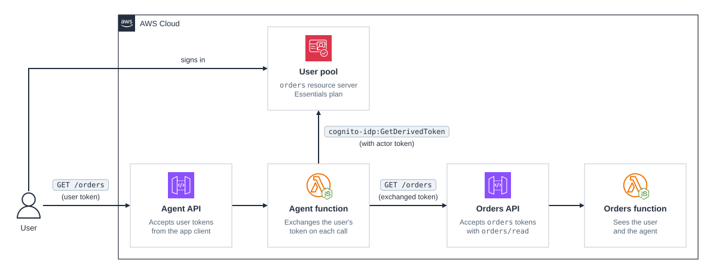

# cdk-cognito-token-exchange

CDK app where an agent calls a downstream API on a user's behalf with an [Amazon Cognito token exchange](https://docs.aws.amazon.com/cognito/latest/developerguide/cognito-user-pools-token-exchange.html) ([RFC 8693](https://www.rfc-editor.org/rfc/rfc8693)), instead of forwarding the user's own token.

A user signs in and calls the agent API with their access token. The agent passes that token to Cognito's `GetDerivedToken` with its own token as the actor, and gets back a token that still names the user, is bound to the orders API's audience, carries only `orders/read`, and has an `act` claim naming the agent. The orders API accepts only tokens bound to its audience, so the user's original token, which carries more scopes, is rejected there.

## Prerequisites

- **_AWS:_**
  - Must have authenticated with [Default Credentials](https://docs.aws.amazon.com/cdk/v2/guide/cli.html#cli_auth) in your local environment.
  - Must have completed the [CDK bootstrapping](https://docs.aws.amazon.com/cdk/v2/guide/bootstrapping.html) for `eu-central-1`, where the app is pinned.
- **_mise:_**
  - [Install mise](https://mise.jdx.dev/installing-mise.html), which manages the required toolchain.
- **_Usage tools:_**
  - The [AWS CLI](https://docs.aws.amazon.com/cli/latest/userguide/getting-started-install.html), `curl`, and [jq](https://jqlang.org/download/).

## Installation

```sh
mise install
pnpm install
```

## Deployment

```sh
pnpm run deploy
```

The stack outputs `UserPoolId`, `AppClientId`, `AgentApiUrl`, and `OrdersApiUrl`.

## Usage

Read the outputs into your shell:

```sh
output() {
  aws cloudformation describe-stacks --region eu-central-1 \
    --stack-name cdk-cognito-token-exchange-dev \
    --query "Stacks[0].Outputs[?OutputKey=='$1'].OutputValue" --output text
}
USER_POOL_ID=$(output UserPoolId)
APP_CLIENT_ID=$(output AppClientId)
AGENT_API_URL=$(output AgentApiUrl)
ORDERS_API_URL=$(output OrdersApiUrl)
```

Create a user with a permanent password of your choice, which must have at least 8 characters with an uppercase letter, a lowercase letter, a number, and a symbol:

```sh
PASSWORD='<password>'
aws cognito-idp admin-create-user --region eu-central-1 --user-pool-id "$USER_POOL_ID" \
  --username demo-user --message-action SUPPRESS
aws cognito-idp admin-set-user-password --region eu-central-1 --user-pool-id "$USER_POOL_ID" \
  --username demo-user --password "$PASSWORD" --permanent
```

Sign in as the user. The access token carries `aws.cognito.signin.user.admin`, `orders/read`, and `orders/write`, and no `aud` claim:

```sh
ACCESS_TOKEN=$(aws cognito-idp initiate-auth --region eu-central-1 --client-id "$APP_CLIENT_ID" \
  --auth-flow USER_PASSWORD_AUTH \
  --auth-parameters USERNAME=demo-user,PASSWORD="$PASSWORD" \
  --query AuthenticationResult.AccessToken --output text)
```

Ask the agent for the user's orders:

```sh
curl -s -H "Authorization: Bearer $ACCESS_TOKEN" "$AGENT_API_URL/orders" | jq
```

The agent returns the claims of the token it exchanged for, and the orders API's answer. `<agent-client-id>` is the ID of the agent's app client:

```json
{
  "exchangedToken": {
    "sub": "<user-sub>",
    "client_id": "<agent-client-id>",
    "aud": "orders",
    "scope": "orders/read",
    "act": {
      "sub": "<agent-client-id>",
      "client_id": "<agent-client-id>",
      "iss": "https://cognito-idp.eu-central-1.amazonaws.com/<user-pool-id>",
      "token_type": "urn:ietf:params:oauth:token-type:access_token"
    },
    "exp": 1794956790
  },
  "ordersApi": {
    "user": "<user-sub>",
    "actor": "<agent-client-id>",
    "orders": [
      { "id": "ord-1001", "item": "Coffee beans", "quantity": 2 },
      { "id": "ord-1002", "item": "Grinder", "quantity": 1 }
    ]
  }
}
```

The same user token sent straight to the orders API is rejected, because it isn't bound to the `orders` audience:

```sh
curl -s -i -H "Authorization: Bearer $ACCESS_TOKEN" "$ORDERS_API_URL/orders"
```

```text
HTTP/2 401
www-authenticate: Bearer scope="orders/read" error="invalid_token" error_description="the token does not have a valid audience"
```

## Cleanup

```sh
pnpm destroy
```

This removes every stack resource, including the user pool with its users and domain, and the functions' log groups.

## Architecture Diagram



### Design Notes

- **Delegation, not impersonation.** Without an actor token, an exchanged token looks as if the user called the orders API directly. With one, the `act` claim tells the orders API, and its logs, that the agent is acting for the user. The agent client allows only `ALLOW_TOKEN_EXCHANGE_DELEGATION`, so it can't make an exchange without naming itself.
- **Down-scoping.** Cognito grants the intersection of the scopes requested, the scopes in the user's token, and the scopes the agent client is allowed. The agent client is allowed only `orders/read`, so no exchange it makes can carry `orders/write`, even for a user who has it.
- **No refresh token.** An exchanged token comes without a refresh token and can't outlive the user's token, so the agent exchanges on each request and keeps nothing for the user.

## Application Details

- User pool
  - On the Essentials feature plan, which token exchange and access token customization both need. Self sign-up is off; users sign in with a username.
  - `orders` resource server with the scopes `orders/read` and `orders/write`.
  - A [pre token generation trigger](./src/functions/pre-token-generation/index.ts) (event version `V2_0`) adds both orders scopes to every user's access token, because tokens from API sign-in carry only `aws.cognito.signin.user.admin`. Token exchange invokes the trigger too, and Cognito removes the scopes it adds there that the exchange didn't request.
  - A prefix domain, `token-exchange-<suffix>`, for the token endpoint. The suffix is the last part of the stack's ID, because prefixes are unique per Region.
- App clients
  - `AppClient` is the app users sign in to. It has no secret, allows `ALLOW_USER_PASSWORD_AUTH` and `ALLOW_REFRESH_TOKEN_AUTH`, and has OAuth turned off.
  - `AgentClient` is the agent. It has a secret, the client credentials grant for `orders/read`, and the explicit auth flow `ALLOW_TOKEN_EXCHANGE_DELEGATION`. The `UserPoolClient` L2 construct has no option for the token-exchange flows, so the stack sets them on its `CfnUserPoolClient`, and acknowledges `CloudFormation-Validate::W3030` there because the CloudFormation Validate schemas bundled with `aws-cdk-lib` don't list them yet.
- Agent API (HTTP API)
  - `GET /orders` uses a JWT authorizer whose audience is `AppClient`'s ID, which access tokens carry as `client_id`, and requires the scope `aws.cognito.signin.user.admin`, which rules out ID tokens with the same audience.
  - The [agent function](./src/functions/agent/index.ts) reads its client secret with `DescribeUserPoolClient` at startup. For each request it gets an actor token from the token endpoint with a client credentials grant, reusing it until a minute before it expires, then calls `GetDerivedToken` with the user's token as the subject token, `Audiences: ["orders"]`, and `Scopes: ["orders/read"]`, and calls the orders API with the result. `GetDerivedToken` is newer than the AWS SDK in the Lambda runtime, so the function bundles its own.
  - The actor token comes from the token endpoint because the domainless `GetClientToken` needs `ALLOW_CLIENT_TOKEN_AUTH`, which must be an app client's only auth flow.
  - The token endpoint also accepts token-exchange grants (`urn:ietf:params:oauth:grant-type:token-exchange`), but it rejects them for this app's users with `invalid_request` and `token_exchange_requires_managed_login`, even on a managed login domain, so the agent calls `GetDerivedToken` instead.
- Orders API (HTTP API)
  - `GET /orders` uses a JWT authorizer whose audience is `orders`, which only exchanged tokens carry as `aud`, and requires the scope `orders/read`.
  - The [orders function](./src/functions/orders/index.ts) returns sample orders with the user's `sub` and the actor's `sub`. API Gateway passes nested claims such as `act` to the function as flattened strings, so it reads them from the verified token instead.
- Functions run on Node.js 24 on Arm with JSON logs, and the stack owns their log groups.
