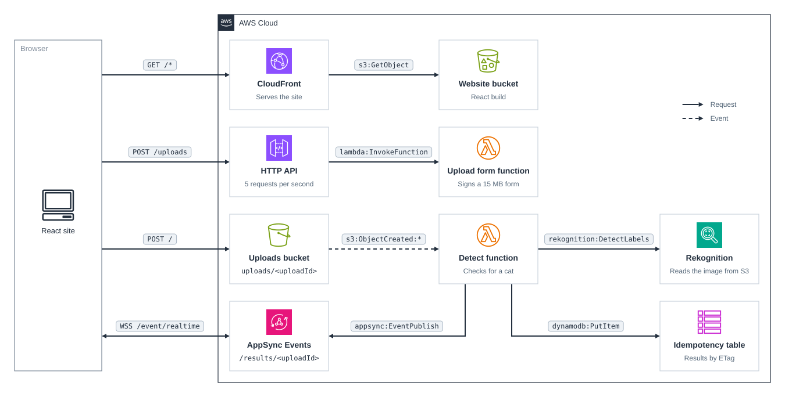
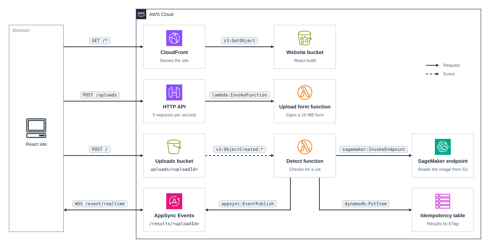

# cdk-detect-labels

CDK app that detects whether an uploaded image contains a cat, with Amazon Rekognition or with an open model on a SageMaker Serverless Inference endpoint, and pushes the result back to the browser with AppSync Events.

## Prerequisites

- **_AWS:_**
  - Must have authenticated with [Default Credentials](https://docs.aws.amazon.com/cdk/v2/guide/cli.html#cli_auth) in your local environment.
  - Must have completed the [CDK bootstrapping](https://docs.aws.amazon.com/cdk/v2/guide/bootstrapping.html) for the target AWS environment.
  - For `-c detector=sagemaker` or `all`, must deploy to a Region that offers [Serverless Inference](https://docs.aws.amazon.com/sagemaker/latest/dg/serverless-endpoints.html).
- **_Docker:_**
  - For `-c detector=sagemaker` or `all`, must be running, to build the model's container image.
- **_mise:_**
  - [Install mise](https://mise.jdx.dev/installing-mise.html), which manages the required toolchain.

## Installation

```sh
mise install
pnpm install
```

## Deployment

```sh
pnpm run deploy
```

This deploys the Rekognition detector, which needs no Docker. To use the open model on SageMaker instead, or to deploy both side by side as two independent stacks, pass `-c detector=sagemaker` or `-c detector=all`:

```sh
pnpm run deploy -c detector=sagemaker
```

Deploying builds the React site in `src/website` first. For SageMaker it also builds the model image in `src/model`, and the stack takes about 13 minutes, most of it creating the endpoint. The script sets `BUILDX_NO_DEFAULT_ATTESTATIONS=1`, because SageMaker only accepts images with Docker v2 manifests, which BuildKit can't produce while it adds its default attestations; deploy with the script rather than with `cdk deploy`.

## Usage

1. Access the website by clicking the `<CLOUDFRONT_DISTRIBUTION_URL>` from the deployment outputs:

   ```sh
   Outputs:
   WebsiteDistributionUrl = <CLOUDFRONT_DISTRIBUTION_URL>
   ```

2. Drop a JPEG or PNG of up to 15 MB on the page and click `Analyze`. The page shows the upload progress, then the verdict, the detected labels, and a box around each cat:

   | Rekognition                                                | SageMaker                                              |
   | ---------------------------------------------------------- | ------------------------------------------------------ |
   |  |  |

## How it works

The browser asks the API for a presigned `POST` form for one `image/jpeg` or `image/png` object. The form's policy caps the size at 15 MB, which a presigned `PUT` URL cannot do, and the key is `uploads/<uploadId>`. Before uploading, the browser subscribes to the AppSync Events channel `/results/<uploadId>` with a subscribe-only API key.

S3 invokes the detect function for each new object under `uploads/`. The function asks the detector for the labels, keeps the boxes of the cats, and publishes the result to the channel with its IAM role. The browser draws it as soon as it arrives.

- The channel handler only lets a client subscribe to an exact `/results/<uploadId>`, never to a wildcard, so the public API key cannot read other uploads' results. The key expires after 365 days, the longest AppSync allows; redeploy to issue a new one.
- Results are cached by the image's ETag for a day, so uploading the same image again skips the detector, and the page says the result was reused. A second upload that arrives while the first is still being detected waits for its result.
- A file that is not a readable JPEG or PNG is published as `unsupported`, instead of failing and being retried.
- The function keeps 3 seconds of its timeout back, so a detection that runs too long is published as an error rather than left unanswered. Events that still fail after one retry go to the `detect-labels-failures` queue, and events older than 5 minutes are dropped, since the page stopped waiting long before.
- Uploads expire after a day, and the API allows 5 requests per second, which still allows about 432,000 detections a day on a public URL. SageMaker is also capped by the endpoint's 5 concurrent requests.
- CloudFront redirects HTTP to HTTPS and adds the managed security headers. The hashed files under `assets/` are cached for a year, and `index.html` and `config.json` are revalidated on every load, so a deploy takes effect at once.

### Rekognition

The function calls `DetectLabels` with a minimum confidence of 75 and takes the cat's bounding boxes from the `Cat` label, its aliases, and its children, such as breeds.

### SageMaker

The function invokes a SageMaker Serverless Inference endpoint with the object's bucket and key, and the model container reads the image from S3 itself: serverless endpoints accept at most 4 MB per request, and uploads can be 15 MB.

- **Model:** [`ustc-community/dfine-large-coco`](https://huggingface.co/ustc-community/dfine-large-coco), D-FINE-L, an Apache-2.0 COCO object detector with 31M parameters. Its weights are pinned to a commit and baked into the image, so a container downloads nothing when it starts. Objects below a score of 0.5 are dropped, and each `cat` gets a bounding box.
- **Container:** `src/model` is a uv project with the CPU build of PyTorch and Transformers, and `serve.py` answers SageMaker's `/ping` and `/invocations` on port 8080. It turns each image upright by its EXIF orientation, as the browser shows it, and decodes large JPEGs at a reduced scale, since the model sees 640×640 pixels. The image is about 0.5 GB compressed in ECR.
- **Endpoint:** 6 GB of memory, the most Serverless Inference offers, which also gives the most vCPUs, and at most 5 concurrent requests. It scales to zero when idle, so the first request after a while waits about 16 seconds for a new container. Provisioned concurrency in the serverless config would remove that wait, but is billed while idle.
- **Permissions:** the endpoint's role can pull the image, read `uploads/*`, and write to its own log group, which the stack creates so that it is deleted with the stack.

Unlike Rekognition, the model only knows the 80 COCO classes. Like Rekognition, it calls a lynx a cat.

### Rekognition vs SageMaker

|                         | Rekognition                                                               | SageMaker Serverless                                                                    |
| ----------------------- | ------------------------------------------------------------------------- | --------------------------------------------------------------------------------------- |
| Price in `eu-central-1` | $0.001 per image                                                          | $0.00012 per second of inference at 6 GB, plus $0.016 per GB of payload                 |
| Free tier               | 1,000 images a month for 12 months, on accounts created before 2025-07-15 | 150,000 seconds a month for the first 2 months, on accounts created before 2025-07-15   |
| Cost of one warm image  | $0.001                                                                    | about $0.0001, for 0.75 to 1 s of model time                                            |
| Latency                 | 1.5 to 2 s end to end                                                     | 1.6 to 3 s end to end when warm; 16 s for the first request after the endpoint was idle |
| Labels                  | Thousands, with parents and aliases                                       | 80 COCO classes                                                                         |
| Deploy                  | About 4 minutes, no Docker                                                | About 13 minutes, with Docker                                                           |

Prices are from the [Rekognition](https://aws.amazon.com/rekognition/pricing/) and [SageMaker AI](https://aws.amazon.com/sagemaker/ai/pricing/) pricing pages as of October 2026. Accounts created since 2025-07-15 get the credit-based [AWS Free Tier](https://aws.amazon.com/free/) instead.

## Cleanup

```sh
pnpm destroy -c detector=all
```

With `-c detector=all` the app includes both stacks, so this removes whichever you deployed. It deletes every resource, including the buckets and their objects, and for SageMaker the endpoint and its log group. It leaves the two log groups that Lambda creates for CDK's own helper functions in each stack, `/aws/lambda/cdk-detect-labels-rekogni-BucketNotificationsHandl-*` and `/aws/lambda/cdk-detect-labels-rekogni-CustomS3AutoDeleteObject-*`, or `sagemak` in place of `rekogni`, and the model image in the CDK bootstrap's container assets repository.

## Architecture Diagrams

### Rekognition



### SageMaker


