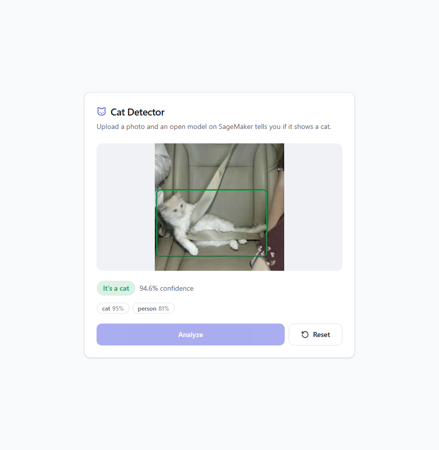
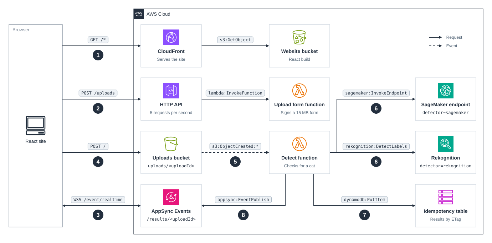

# cdk-detect-labels

CDK app that detects whether an uploaded image contains a cat, with Amazon Rekognition or with an open model on a SageMaker Serverless Inference endpoint, and pushes the result back to the browser with AppSync Events.

### Related Apps

- [cdk/appsync-events](../../cdk/appsync-events) - Handles AppSync Events channels with Lambda and DynamoDB data sources.

## Prerequisites

- **_AWS:_**
  - Must have authenticated with [Default Credentials](https://docs.aws.amazon.com/cdk/v2/guide/cli.html#cli_auth) in your local environment.
  - Must have completed the [CDK bootstrapping](https://docs.aws.amazon.com/cdk/v2/guide/bootstrapping.html) for the target AWS environment.
- **_Docker:_**
  - Must be running for the SageMaker detector, to build the model's container image.
- **_mise:_**
  - [Install mise](https://mise.jdx.dev/installing-mise.html), which manages the required toolchain.

## Installation

```sh
mise install
pnpm install
```

## Deployment

```sh
pnpm run deploy
```

This deploys the Rekognition detector. Pass `-c detector=sagemaker` for the open model on SageMaker, or `-c detector=all` for both as two independent stacks:

```sh
pnpm run deploy -c detector=sagemaker
```

Deploy with the script rather than with `cdk deploy`: it builds the website first, and sets `BUILDX_NO_DEFAULT_ATTESTATIONS=1` so that the model image has the Docker v2 manifest SageMaker requires.

## Usage

1. Access the website by clicking the `<CLOUDFRONT_DISTRIBUTION_URL>` from the deployment outputs:

   ```sh
   Outputs:
   WebsiteDistributionUrl = <CLOUDFRONT_DISTRIBUTION_URL>
   ```

2. Drop a JPEG or PNG of up to 15 MB on the page and click `Analyze`. The page shows the verdict, the detected labels, and a box around each cat:

   | Rekognition                                                | SageMaker                                              |
   | ---------------------------------------------------------- | ------------------------------------------------------ |
   |  |  |

## Cleanup

```sh
pnpm destroy -c detector=all
```

This removes whichever stacks you deployed, including the buckets and their objects. It leaves the log groups that Lambda creates for CDK's helper functions, `/aws/lambda/cdk-detect-labels-<rekogni|sagemak>-BucketNotificationsHandl-*` and `-CustomS3AutoDeleteObject-*`, and for SageMaker the model image in the CDK bootstrap's container assets repository.

## Architecture Diagram



1. **Loading the site**
   - CloudFront serves the React build from the website bucket.

2. **Getting an upload form**
   - The site asks the HTTP API for a presigned `POST` form, which caps the upload at 15 MB.

3. **Subscribing to the result**
   - The site subscribes to the AppSync Events channel `/results/<uploadId>`.

4. **Uploading the image**
   - The browser posts the image straight to the uploads bucket with the form.

5. **Invoking the detect function**
   - S3 invokes the detect function for the new object.

6. **Detecting the labels**
   - **Rekognition:** the function calls `DetectLabels` and keeps the boxes of the `Cat` label and its breeds.
   - **SageMaker:** the function invokes the endpoint with the image's S3 location, and the [model container](./src/model) reads the image and runs D-FINE-L. The endpoint scales to zero when idle.

7. **Caching the result**
   - The function stores the result in the idempotency table, keyed by the image's ETag.

8. **Publishing the result**
   - The function publishes the result, or an error, to the channel, and the page shows it.

### Design Notes

- **One detector per stack.** The detect function calls Rekognition or the SageMaker endpoint, chosen at deploy time with `-c detector`. `-c detector=all` deploys two separate stacks, each with its own copy of every resource.
- **Subscribing before uploading.** AppSync Events delivers an event only to the subscribers connected when it is published, and the result can follow the upload within seconds, so the site subscribes first.
- **The image by reference.** Serverless Inference caps a request at 4 MB and an upload can be 15 MB, so the function sends the endpoint the image's S3 location and the container reads the image itself.
- **Results cached by ETag.** A result is kept for a day, so uploading the same image again skips the detector, and two uploads of the same image at the same time share one detection. The SageMaker stack includes the model version in the key, so a new model doesn't reuse old results.
- **An error instead of silence.** The function keeps 3 seconds of its timeout back, so when detection fails or runs out of time it still publishes an error, and the page shows it rather than waiting for its own timeout.

## Comparison

Measured by uploading the same 51 photos (33 cats, 17 other animals, and a European wildcat left out of the counts) through each deployed stack in `eu-central-1`, one at a time.

### Cost

For the 51 photos, with `eu-central-1` list prices as of 31 October 2026:

|                | Rekognition | SageMaker Serverless                       |
| -------------- | ----------- | ------------------------------------------ |
| Billing unit   | One image   | One second of inference, at 6 GB of memory |
| Units billed   | 51 images   | 43 seconds                                 |
| Price per unit | $0.0012     | $0.00012                                   |
| Total cost     | $0.061      | $0.0052                                    |
| Cost per photo | $0.0012     | $0.0001                                    |

The rest of each stack, everything but the detector, cost under $0.002.

### Behavior

|                              | Rekognition                         | SageMaker Serverless                        |
| ---------------------------- | ----------------------------------- | ------------------------------------------- |
| Upload to result, warm       | 2.5 s median                        | 3.1 s median                                |
| Upload to result, cold start | No cold start                       | About 16 s                                  |
| Labels                       | Thousands, with parents and aliases | The 80 COCO classes, so any feline is a cat |
| Cats found                   | 31 of 33                            | 32 of 33                                    |
| Other animals called a cat   | 5 of 17                             | 10 of 17                                    |
| Deploy time                  | About 4 minutes                     | About 13 minutes                            |
