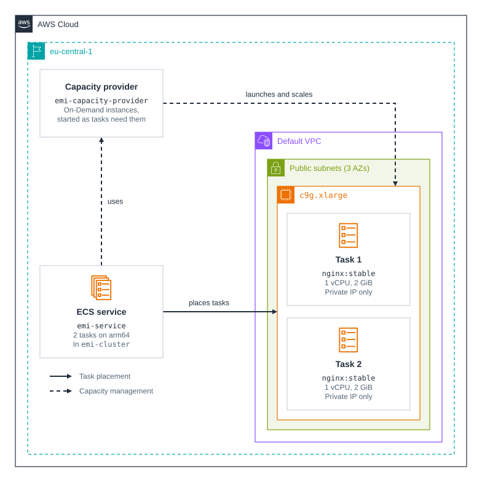

# cdk-ecs-managed-instances

CDK app that deploys an ECS service with an ECS MI (ECS Managed Instances) capacity provider. This repository is intended to demonstrate [Amazon ECS Managed Instances](https://docs.aws.amazon.com/AmazonECS/latest/developerguide/ManagedInstances.html).

### Related Apps

- [cdk/lambda-managed-instances](../lambda-managed-instances) - Runs a minimal function on Lambda Managed Instances from a zip archive.

## Prerequisites

- **_AWS:_**
  - Must have authenticated with [Default Credentials](https://docs.aws.amazon.com/cdk/v2/guide/cli.html#cli-auth) in your local environment.
  - Must have completed the [CDK bootstrapping](https://docs.aws.amazon.com/cdk/v2/guide/bootstrapping.html) for the target AWS environment.
  - Must have a default VPC in `eu-central-1`.
- **_mise:_**
  - [Install mise](https://mise.jdx.dev/installing-mise.html), which manages the required toolchain.

## Installation

```sh
mise install
pnpm install
```

## Deployment

```sh
pnpm run deploy
```

## Usage

Tasks have no public IP, so check them through ECS. Both report `HEALTHY` once nginx answers the container health check:

```sh
aws ecs describe-tasks --region eu-central-1 --cluster emi-cluster \
  --tasks $(aws ecs list-tasks --region eu-central-1 --cluster emi-cluster --query 'taskArns' --output text) \
  --query 'tasks[].[lastStatus,healthStatus,availabilityZone]' --output table
```

## Cleanup

```sh
pnpm destroy
```

This also terminates the instance. ECS keeps the task definition as an `INACTIVE` revision, which costs nothing.

## Architecture Diagram



## Application Details

- ECS rejects `assignPublicIp` for Managed Instances, so each task gets a private IP on a branch of the instance's trunk network interface. Reaching nginx from outside the VPC needs a load balancer, which this app doesn't deploy.
- The instance gets a public IP from the default VPC's subnets, so the app needs no NAT gateway.
- ECS places both tasks on one `c9g.xlarge`, where 4 vCPUs and 8 GiB fit them, so a single instance failure can stop both.
- The [supported instance types](https://docs.aws.amazon.com/AmazonECS/latest/developerguide/managed-instances-instance-types.html) page doesn't list C9g yet, but `c9g.xlarge` launches.
