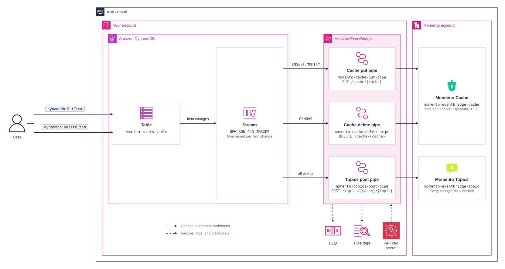

# cdk-eventbridge-webhooks-momento

CDK app that demonstrates how to use Amazon EventBridge to send webhook events to Momento.

> [!NOTE]
> Momento retired its free tier in late 2025, so running this example needs a paid Momento account.

## Prerequisites

- **_AWS:_**
  - Must have authenticated with [Default Credentials](https://docs.aws.amazon.com/cdk/v2/guide/cli.html#cli_auth) in your local environment.
  - Must have completed the [CDK bootstrapping](https://docs.aws.amazon.com/cdk/v2/guide/bootstrapping.html) for the target AWS environment.
- **_Momento:_**
  - Must have created a cache named `momento-eventbridge-cache` in your Momento account.
  - Must have created a Momento API key and stored it in AWS Secrets Manager as a secret named `momento-api-key`, so the key never appears in the CloudFormation template:

    ```sh
    aws secretsmanager create-secret --name momento-api-key --secret-string "$MOMENTO_API_KEY"
    ```

  - Must have set the `MOMENTO_ENDPOINT` variable, the endpoint of your cache's Region such as `cell-1-eu-central-1-1.prod.a.momentohq.com` (see [Momento regions](https://docs.momentohq.com/platform/regions)), in your local environment. The stack calls Momento's HTTP API at `https://api.cache.$MOMENTO_ENDPOINT`.
- **_mise:_**
  - [Install mise](https://mise.jdx.dev/installing-mise.html), which manages the required toolchain.

## Installation

```sh
mise install
pnpm install
```

## Deployment

```sh
pnpm run deploy
```

## Usage

Both demo apps write to the `weather-stats-table` DynamoDB table with your default AWS credentials and read the Momento cache and topic. They need `MOMENTO_API_KEY` and `MOMENTO_ENDPOINT` in the environment or in a `.env` file in the app's directory.

### CLI App

Puts a random weather record in the table, waits for the pipes to put it in the cache and publish it to the topic, then deletes it and waits for it to leave the cache.

```sh
pnpm -C src/demo/cli start
```

### Web App

Runs only on your machine. The Vite dev server calls DynamoDB for the page and gives it a disposable Momento token, valid for 30 minutes, that can only read the cache and subscribe to the topic, so neither your AWS credentials nor the Momento API key reach the browser.

```sh
pnpm -C src/demo/web dev
```

## Cleanup

```sh
pnpm destroy
```

This removes the table, the queue, the pipes, and their log group. The `momento-api-key` secret and the Momento cache stay until you delete them.

## Architecture Diagram


