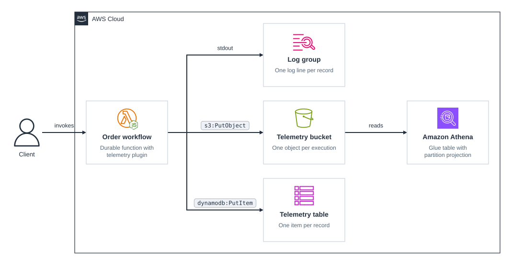

# cdk-lambda-durable-functions-telemetry

CDK app that runs an order workflow as a [Lambda durable function](https://docs.aws.amazon.com/lambda/latest/dg/durable-functions.html) and observes it with the [Durable Execution Telemetry Exporter](https://docs.aws.amazon.com/durable-execution/sdk-reference/observability/telemetry/exporter/).

The exporter is a plugin for the durable execution SDK that runs in the function's own process. When an execution ends, it writes one JSON record with the execution's status, timing, input, output, error, and every step and wait. This app sends each record to three destinations: the function's log group for CloudWatch Logs Insights, a DynamoDB table for lookups by execution, and an S3 bucket that Athena queries through a Glue table.

## Prerequisites

- **_AWS:_**
  - Must have authenticated with [Default Credentials](https://docs.aws.amazon.com/cdk/v2/guide/cli.html#cli_auth) in your local environment.
  - Must have completed the [CDK bootstrapping](https://docs.aws.amazon.com/cdk/v2/guide/bootstrapping.html) for `eu-central-1`, where the app is pinned.
- **_mise:_**
  - [Install mise](https://mise.jdx.dev/installing-mise.html), which manages the required toolchain.

## Installation

```sh
mise install
pnpm install
```

## Deployment

```sh
pnpm run deploy
```

## Usage

Start 100 executions, or pass another count:

```sh
pnpm start-executions
pnpm start-executions 500
```

Each execution takes 10 to 30 seconds. Orders above 1,000 are declined, so about one in five fails, and the inventory step fails 30% of its attempts and is retried.

### CloudWatch Logs Insights

Each record is an `INFO` line in `/aws/lambda/durable-order-workflow`. To list the slowest failures, run this query on that log group:

```text
filter level = "INFO" and message like /DurableExecutionTelemetry/
| parse message '"executionName":"*"' as executionName
| parse message '"status":"*"' as status
| parse message '"durationMs":*,' as durationMs
| filter status = "FAILED"
| display executionName, status, tonumber(durationMs) as ms
| sort ms desc
```

### DynamoDB

The table keeps every record, keyed by execution ARN (`pk`) and emit time (`sk`). To read the error of every failed execution:

```sh
aws dynamodb scan --region eu-central-1 --table-name durable-order-telemetry \
  --filter-expression '#status = :failed' \
  --expression-attribute-names '{"#status": "status"}' \
  --expression-attribute-values '{":failed": {"S": "FAILED"}}' \
  --query 'Items[].[executionName.S, error.M.name.S, error.M.cause.M.name.S, error.M.message.S]' \
  --output table
```

The [telemetry MCP server](https://docs.aws.amazon.com/durable-execution/sdk-reference/observability/telemetry/mcp/) lets an agent list, read, and query the same records. To add it to Claude Code:

```sh
claude mcp add durable-telemetry \
  --env DURABLE_TELEMETRY_DESTINATION_TYPE=dynamodb \
  --env DURABLE_TELEMETRY_DYNAMODB_TABLE_NAME=durable-order-telemetry \
  --env DURABLE_TELEMETRY_REGION=eu-central-1 \
  -- npx -y @aws/durable-execution-sdk-js-telemetry-mcp
```

The server asks you to confirm that its credentials are read-only before its first query, because the agent writes the queries.

### Athena

The S3 exporter writes one object per execution under `durable-execution-telemetry/year=/month=/day=`. To see how each operation behaved across all executions:

```sh
id=$(aws athena start-query-execution --region eu-central-1 \
  --work-group durable-order-telemetry \
  --query-execution-context Database=durable_order_telemetry \
  --query-string "SELECT op.name, count(*) AS runs,
      count_if(op.status = 'FAILED') AS failed, max(op.attempt) AS max_attempt,
      approx_percentile(op.durationms, 0.5) AS p50_ms
    FROM durable_execution_telemetry CROSS JOIN UNNEST(operations) AS t(op)
    GROUP BY op.name ORDER BY op.name" \
  --query QueryExecutionId --output text)
until aws athena get-query-execution --region eu-central-1 --query-execution-id "$id" \
  --query QueryExecution.Status.State --output text | grep -qvE 'QUEUED|RUNNING'; do sleep 1; done
aws athena get-query-results --region eu-central-1 --query-execution-id "$id" \
  --query 'ResultSet.Rows[*].Data[*].VarCharValue' --output text
```

After one run of `pnpm start-executions`, it prints something like this, where the wait has no attempt count:

```text
name                runs  failed  max_attempt  p50_ms
charge-payment      100   18      1            24
fraud-check-window  100   0       10000
reserve-inventory   100   0       4            0
validate-order      100   0       1            0
```

### Lambda APIs

Lambda keeps each execution's history for a day. Listing by function takes a version, not the alias:

```sh
version=$(aws lambda get-alias --region eu-central-1 --function-name durable-order-workflow \
  --name live --query FunctionVersion --output text)
aws lambda list-durable-executions-by-function --region eu-central-1 \
  --function-name durable-order-workflow --qualifier "$version" \
  --query 'DurableExecutions[].[DurableExecutionName, Status]' --output text
```

## Cleanup

```sh
pnpm destroy
```

This removes every stack resource, including the table, the bucket with its records and Athena results, the Glue database and table, the Athena workgroup, and the function's log group. Deleting a durable function waits for its running executions to end, which takes at most 30 seconds here. Lambda creates the bucket auto-delete function's log group outside the stack, so it remains until you delete it.

## Architecture Diagram



## Application Details

- `durable-order-workflow`
  - A Node.js 24 function on arm64 with `durableConfig` set, which can only be set when the function is created. Each invocation may run for 30 seconds; an execution, waits included, may run for 15 minutes.
  - Durable functions accept only qualified invocations, so `start-executions` invokes the `live` alias, which points at the latest published version. An execution stays on the version it started on, even if the alias moves while it waits.
  - The [workflow](./src/functions/order-workflow/index.ts) validates the order, reserves inventory with up to five attempts, waits 10 seconds, and charges the payment once, with no retries. During the wait, the function suspends and Lambda invokes it again when the wait ends. The SDK replays the completed steps from their checkpoints rather than running them again.
  - `start-executions` names each execution after its order ID, so starting the same order twice does not start a second execution.
- Telemetry
  - The plugin emits one record per execution when it ends (`emitMode: "on-complete"`, the default). Set `emitMode: "on-change"` to also record each operation as it starts and ends, or `samplingRate` to record a fraction of executions.
  - The function's records name the SDK's error classes, such as `StepError` with a `PaymentError` cause. Minifying would rename those classes, so the bundle keeps names.
  - The bundle includes the AWS SDK rather than using the runtime's copy, so it pins the client versions the SDK and exporter call. The exporter imports a client for every destination it supports, so all of them are dependencies even though the app uses only two.
  - The role may only `PutItem` to the table and `PutObject` under the exporter's prefix. The log exporter writes to standard output and needs no permissions. A failed export never fails the execution.
- Athena
  - The Glue table uses partition projection, so Athena computes each day's partition from the S3 key layout, and a new day needs no crawler or `MSCK REPAIR TABLE`.
  - The JSON SerDe is case-sensitive, with a mapping for each camelCase key, so keys inside `input` and `output` keep their case for `json_extract_scalar`.
  - The workgroup writes query results under `athena-results/`, outside the table's location, so queries never read their own results back as records.
- Quotas
  - Lambda's default durable function quotas in `eu-central-1` include 3,000 invocations per second that start an execution, 5 million running executions, and 300 `GetDurableExecution` and 150 `ListDurableExecutionsByFunction` requests per second. US East (N. Virginia), US West (Oregon), and Europe (Ireland) have twice these defaults. See [Lambda quotas](https://docs.aws.amazon.com/lambda/latest/dg/gettingstarted-limits.html#durable-functions-quotas).
  - `start-executions` sends 50 invocations at a time. From a laptop in Europe, 100 executions start in under half a second, well below the start rate.
