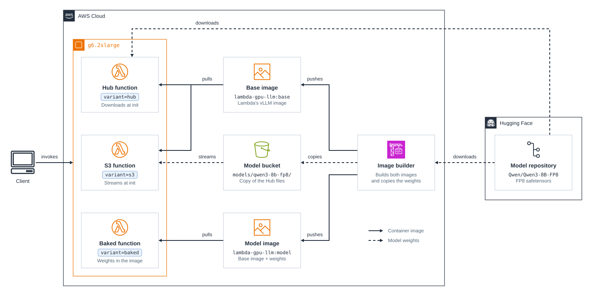

# cdk-lambda-gpu-llm

CDK app that serves [Qwen3-8B-FP8](https://huggingface.co/Qwen/Qwen3-8B-FP8) with [vLLM](https://docs.vllm.ai/) on a GPU through [Lambda Managed Instances](https://docs.aws.amazon.com/lambda/latest/dg/lambda-managed-instances.html), scaling to zero when nobody calls it.

Each function gets one NVIDIA L4 on a `g6.2xlarge` instance and runs Lambda's vLLM container image. Lambda stops the execution environment and the instance after the function sits idle, so the GPU costs nothing between bursts, and the next request waits for both to start again. The app deploys the function in three variants that differ only in where the weights come from, Hugging Face, S3, or the image itself, and measures how long each takes to wake from zero.

## Prerequisites

- **_AWS:_**
  - Must have authenticated with [Default Credentials](https://docs.aws.amazon.com/cdk/v2/guide/cli.html#cli-auth) in your local environment. Synthesizing also needs them, because the app looks up the default VPC.
  - Must have completed the [CDK bootstrapping](https://docs.aws.amazon.com/cdk/v2/guide/bootstrapping.html) for the target AWS environment.
  - The account needs a default VPC in `eu-central-1`, where the app is pinned, and a quota of at least 8 vCPUs for [Running On-Demand G and VT instances](https://console.aws.amazon.com/servicequotas/home/services/ec2/quotas/L-DB2E81BA) for each variant deployed at once. New accounts start at 0.
- **_mise:_**
  - [Install mise](https://mise.jdx.dev/installing-mise.html), which manages the required toolchain.

## Configuration

The app deploys the `s3` variant unless you pick another one with a context value:

| Value   | Deploys                     |
| ------- | --------------------------- |
| `s3`    | The S3 variant, the default |
| `hub`   | The Hugging Face variant    |
| `baked` | The baked variant           |
| `all`   | All three, as three stacks  |

Pass it as `-c variant=<value>` to `pnpm run deploy`, `pnpm destroy`, or any `cdk` command. See [Variants](#variants) for how they differ.

## Installation

```sh
mise install
pnpm install
```

## Deployment

```sh
pnpm run deploy
# or: pnpm run deploy -c variant=all
```

This takes about 45 minutes. It deploys the image stack, then runs its CodeBuild project, which downloads the weights, builds and indexes both image tags, and copies the weights to S3 in about 30 minutes, then deploys the variant stacks, which need both tags to exist.

Lambda starts an instance and an execution environment when it publishes each function, so a variant stack takes 10 to 15 minutes, and its instance stops on its own about 15 minutes later.

## Usage

Ask a variant a question:

```sh
pnpm chat s3 "In two sentences, what is a GPU good for?"
```

When the function has scaled to zero, Lambda throttles requests until the execution environment is ready, and the script retries every 10 seconds until it gets an answer.

Measure how long each deployed variant takes to wake from zero:

```sh
pnpm measure
```

Each of the default three runs waits for the function to scale to zero by itself, then wakes it with a request, so a run takes about 25 minutes. The variants are measured side by side. Each run is printed as a JSON line, and the summary at the end shows the median run of each variant. See [Comparison](#comparison) for results and what each phase means.

## Cleanup

```sh
pnpm destroy
# or: pnpm destroy -c variant=all
```

Pass the same `variant` you deployed, because `pnpm destroy` only removes the stacks the app synthesizes. This deletes the stacks, including the ECR repository with its images, the bucket with the weights, and every function and capacity provider log group. Lambda creates the bucket auto-delete function's log group outside the stack, so it remains until you delete it.

## Architecture Diagram



## Application Details

### Variants

Every variant runs vLLM with the same model on its own capacity provider, so none can reuse image layers that another one pulled.

| Variant | Image tag | Weights                                                                  |
| ------- | --------- | ------------------------------------------------------------------------ |
| `hub`   | `base`    | Downloaded from Hugging Face during initialization                       |
| `s3`    | `base`    | Streamed from the S3 bucket during initialization with the Run:ai loader |
| `baked` | `model`   | In the image, one layer per weights file                                 |

Both tags carry a SOCI index, so Lambda starts the container before the whole image has arrived and fetches files as vLLM reads them.

### GPU settings

The function asks for one GPU with at least 24 GB of memory per execution environment, which on `g6.2xlarge` is the whole L4. `aws-cdk-lib` doesn't model GPUs yet, so `src/stacks/variant-stack.ts` sets them as CloudFormation overrides:

- `AcceleratorConfig` requests the GPU. The schemas bundled with the CDK predate it, so the stack acknowledges the `CloudFormation-Validate::F3002` warning.
- `EphemeralStorage` is 16 GiB, more than the 10 GiB `aws-cdk-lib` allows, so the `hub` variant has room in `/tmp` for its download.

The capacity provider allows only `g6.2xlarge` and caps the fleet at 12 vCPUs, the lowest value Lambda accepts, which still fits only one 8-vCPU instance. The function scales between 0 and 1 execution environments, and each takes 16 GiB of memory at 4 GiB per vCPU.

### Logs

Lambda starts an execution environment when it publishes the function, before CloudFormation has created a log group that depends on the function. Each function therefore gets its own explicitly created log group, which the function depends on. With CDK's default log group, that first environment found no log group, wasn't allowed to create one, and delivered no logs at all.

## Comparison

Measured on 2026-11-26 in `eu-central-1` with `pnpm measure`: 3 wake-ups from zero per variant, the three variants side by side, each on its own `g6.2xlarge`. The table shows each variant's median run by `ready`, in seconds, so its phases add up.

| Variant | request | instance | schedule | environment | answer | ready | ready range |
| ------- | ------: | -------: | -------: | ----------: | -----: | ----: | ----------: |
| `s3`    |     3.7 |     33.3 |      6.8 |       280.5 |    2.3 | 326.6 |   323 - 437 |
| `hub`   |     1.9 |    161.9 |     18.1 |       397.6 |    2.5 | 582.0 |   516 - 823 |
| `baked` |     8.8 |    234.6 |      5.5 |       575.9 |    2.7 | 827.5 |   639 - 854 |

- **request:** from the first throttled request to Lambda asking for an instance.
- **instance:** launching the instance.
- **schedule:** from the launched instance to Lambda creating the execution environment.
- **environment:** pulling the image, starting vLLM, and loading the model.
- **answer:** from the environment being ready to a retried request being answered.
- **ready:** from the first request to its first answer.

The instance launch varied from 16 to 392 seconds whatever the variant, so `environment` is where the variants differ. Across all runs it took 271 to 281 seconds for `s3`, 398 to 410 for `hub`, and 572 to 782 for `baked`. Streaming the weights from S3 with the Run:ai loader beats both downloading them from Hugging Face and lazily loading them from image layers through SOCI.

Once awake, every variant generated 29.5 to 29.7 tokens per second for a single request with 256 output tokens. After the last request, Lambda stopped the execution environment 913 to 975 seconds later, and the instance shortly after that, so each wake-up keeps the GPU running for about 16 more minutes.
