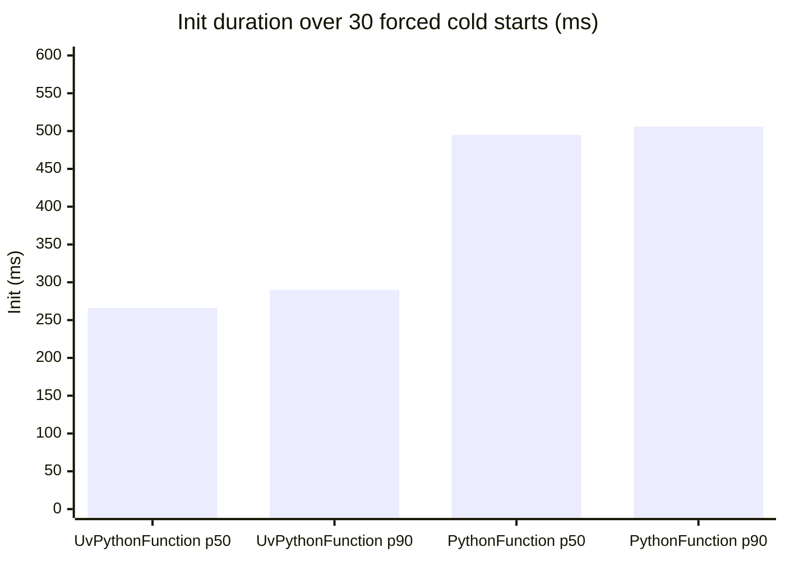
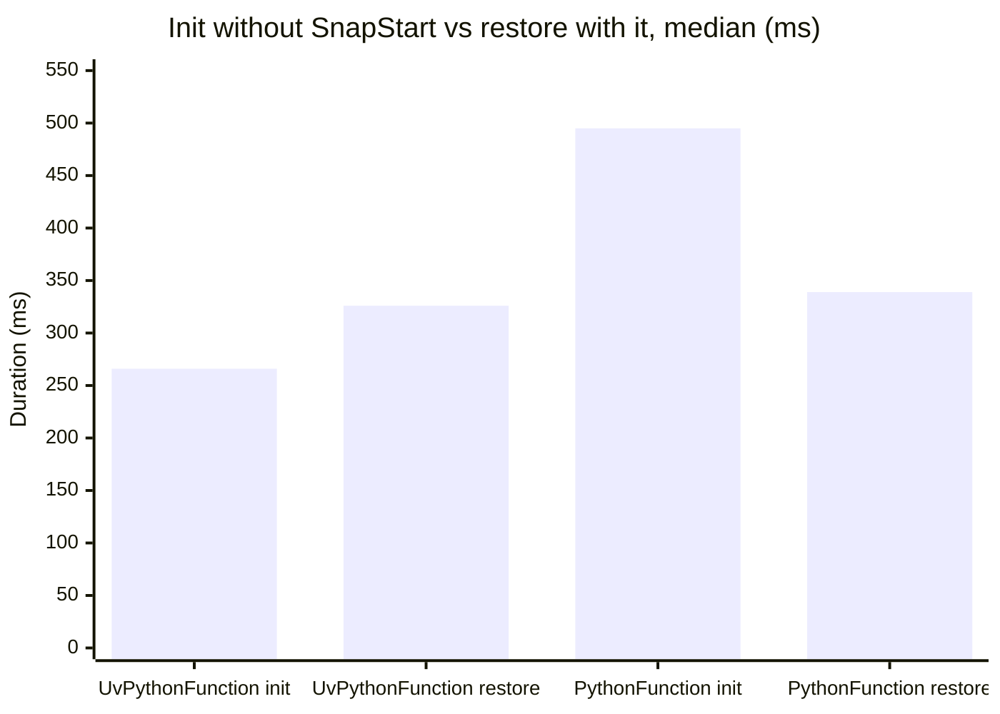
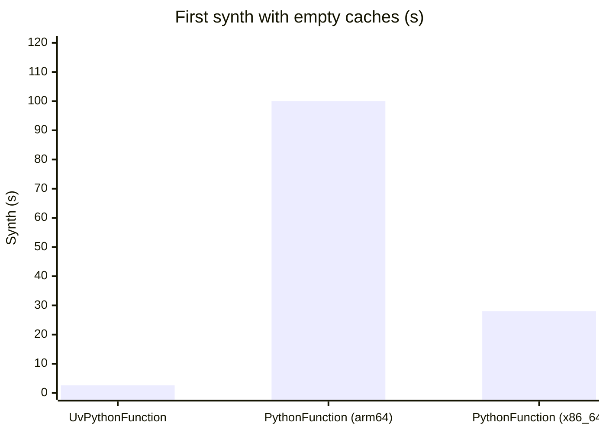

# cdk-lambda-python-uv-enhanced

CDK app that deploys the same Python handler from the same [uv](https://docs.astral.sh/uv/) project twice: with `UvPythonFunction`, a construct in this example that follows uv's [AWS Lambda guide](https://docs.astral.sh/uv/guides/integration/aws-lambda/) and adds what the guide leaves out, and with the official [`PythonFunction`](https://github.com/aws/aws-cdk/tree/main/packages/%40aws-cdk/aws-lambda-python-alpha) from `@aws-cdk/aws-lambda-python-alpha`.

Both functions use the same runtime, architecture, memory, logging and uv version. Each returns a report of how its package was loaded: the interpreter, the CPU, where each module came from, and whether Python could use its shipped bytecode.

## Comparison

Measured in `eu-central-1` on the `python3.14` runtime (Python 3.14.7), arm64, 512 MB. Builds ran on an x86_64 host, timing a whole `cdk synth` with only that function in the stack, as the median of three runs. Each run starts from an empty `cdk.out`, except the handler-only change, which keeps the previous synth's.

### Lambda

| | `UvPythonFunction` | `PythonFunction` |
| --- | --- | --- |
| Init, median of 30 forced cold starts | 266 ms | 495 ms |
| Init, p90 of 30 forced cold starts | 290 ms | 506 ms |
| First invoke after a cold start, median | 2.7 ms | 2.6 ms |
| Warm invoke, median of 50 | 1.9 ms | 1.7 ms |
| Max memory used, median | 60 MB | 64 MB |
| Bytecode on Lambda | Precompiled, hash-based, used as shipped | None shipped, so each module is compiled in memory on every cold start |
| Wheels | `aarch64` | `aarch64` |



Once a function is warm, both run the same code at the same speed; the difference is all in loading it. Lambda has billed the init phase of on-demand functions [since August 2025](https://aws.amazon.com/blogs/compute/aws-lambda-standardizes-billing-for-init-phase/), so a shorter init lowers the bill as well as the latency.

#### SnapStart

The example leaves [SnapStart](https://docs.aws.amazon.com/lambda/latest/dg/snapstart.html) off. These numbers come from the same functions with it turned on (`snapStart: SnapStartConf.ON_PUBLISHED_VERSIONS`), in three rounds per function: each round published a new version and invoked it 12 times at once, so every invocation landed on a freshly restored execution environment (36 restores each).

SnapStart runs the init phase once, when a version is published, and restores later cold starts from a snapshot of it. The official construct compiles its modules during that one init, so its missing bytecode no longer slows its cold starts, and both functions restore in about the same time.

| | `UvPythonFunction` | `PythonFunction` |
| --- | --- | --- |
| Restore, median | 326 ms | 339 ms |
| Restore, p90 | 410 ms | 374 ms |
| Billed restore, median | 49 ms | 55 ms |
| First invoke after a restore, median | 32 ms | 13 ms |
| Max memory used, median | 66 MB | 69 MB |



For a function this small, SnapStart does not beat a package that loads fast on its own: a restore of either function takes longer than `UvPythonFunction`'s plain init, and the first invocation after a restore is slower than one after a plain init. Lambda bills only part of a restore (49 ms of 326 ms here), but SnapStart adds a charge for caching each published version, for at least three hours, and one for each restore. It pays off when init is expensive, as with the official construct's 495 ms, or for functions that load much more code or data.

### Package

| | `UvPythonFunction` | `PythonFunction` |
| --- | --- | --- |
| Deployed, zipped | 5.6 MB | 3.5 MB |
| Unzipped | 15 MB, bytecode included | 10 MB |

Both constructs deploy one zip, so a handler-only change uploads the whole package for either.

### Build

The functions target arm64, and the build host is x86_64, so Docker runs the official construct's arm64 bundling image under QEMU emulation. The last column builds the same function for x86_64, the host's own architecture, to show how much of the time emulation costs. `UvPythonFunction` installs wheels for either target on the host, so its times do not change.

| | `UvPythonFunction` | `PythonFunction` (arm64) | `PythonFunction` (x86_64) |
| --- | --- | --- | --- |
| Needs | uv, with Docker only as a fallback | Docker | Docker |
| Bundling image | None | 3.6 GB, the construct's default, built on the `python3.14` SAM build image | 3.5 GB |
| First synth, empty uv cache or no bundling image | 2.6 s | 100 s | 28 s |
| Synth, caches warm | 1.7 s | 5.1 s | 3.0 s |
| Synth after a handler-only change | 1.8 s | 5.0 s | 3.1 s |



On an arm64 host, such as Apple silicon or Graviton, the emulation cost moves to the x86_64 target instead, so the official construct is fastest when the target matches the host. With a matching target here, its first synth still took more than ten times as long as `UvPythonFunction`'s, and every later one nearly twice as long. The first synth on a new machine also pulls the SAM build image, a 0.9 GB download that these times leave out.

The official construct's default image needs a SAM build image for the function's runtime, which AWS publishes some time after the runtime itself. On the `python3.15` preview runtime, which has none yet, this example had to give the official construct a stand-in image, while `UvPythonFunction` worked unchanged.

## What `UvPythonFunction` does

- **Builds on the host, without Docker.** `uv pip install --python-platform aarch64-manylinux_2_34` installs wheels for Lambda's CPU and Amazon Linux 2023's glibc, whatever the host runs. When uv is missing, the same commands run in the `ghcr.io/astral-sh/uv` image.
- **Installs the project from its current source.** Third-party packages (`uv export --no-emit-local`) and then the project with any workspace members (`--only-emit-local`) install into one zip, like the official construct's. uv reuses a local package's cached build until its `pyproject.toml` changes, so the project installs with `--refresh`; otherwise a handler-only change would deploy the previous code.
- **Ships bytecode Lambda can use.** The CDK CLI zips assets with every file's mtime reset to the same fixed date, so timestamp-based `.pyc` files never match their source on Lambda. They are ignored, and the read-only code directories mean Python compiles every module again on each cold start. The construct compiles with `PYC_INVALIDATION_MODE=UNCHECKED_HASH`, which Python trusts without checking the source.
- **Installs only what the lockfile pins.** `uv export --locked` fails when `uv.lock` no longer matches `pyproject.toml`, dependencies install as wheels only (`--no-build`) and with `--require-hashes`, and `--no-installer-metadata` leaves out the files that would differ between builds.

The bytecode mode is what makes the difference in init time without SnapStart. With `UvPythonFunction` and nothing else changed, the median init over 30 forced cold starts was 266 ms with hash-based `.pyc` files, 494 ms with none, and 532 ms with timestamp-based ones, which the function's report shows as stale. Without bytecode, it initializes as slowly as the official construct.

The Python project sets `exclude-newer = "3 days"`, uv's [dependency cooldown](https://docs.astral.sh/uv/concepts/resolution/#dependency-cooldowns), to match the workspace's pnpm `minimumReleaseAge`. It keeps its package at the project root, because the official construct copies the project directory as-is rather than installing the project.

## Prerequisites

- **_AWS:_**
  - Must have authenticated with [Default Credentials](https://docs.aws.amazon.com/cdk/v2/guide/cli.html#cli-auth) in your local environment.
  - Must have completed the [CDK bootstrapping](https://docs.aws.amazon.com/cdk/v2/guide/bootstrapping.html) for the target AWS environment.
- **_mise:_**
  - [Install mise](https://mise.jdx.dev/installing-mise.html), which manages the required toolchain, including uv.
- **_Docker:_**
  - Must be [installed](https://docs.docker.com/get-docker/) in your system and running at deployment, for the official construct.

## Installation

```sh
mise install
pnpm install
```

## Deployment

```sh
pnpm run deploy
```

Then invoke either function:

```sh
aws lambda invoke --function-name lambda-python-uv-enhanced \
  --cli-binary-format raw-in-base64-out --payload '{"name": "uv"}' response.json
aws lambda invoke --function-name lambda-python-uv-alpha \
  --cli-binary-format raw-in-base64-out --payload '{"name": "uv"}' response.json
```

## Cleanup

```sh
pnpm destroy
```
