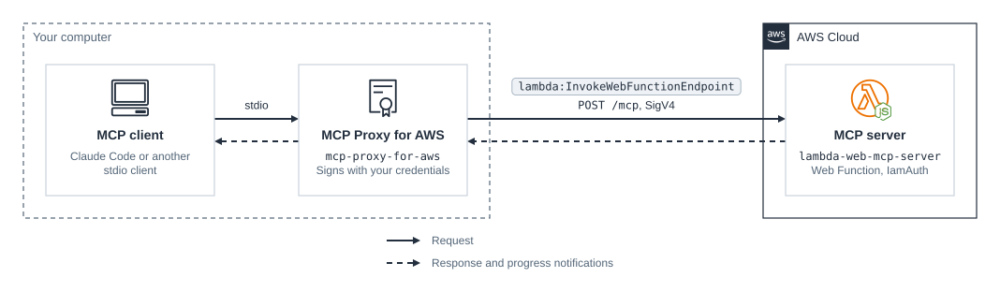

# cdk-lambda-web-mcp-server

CDK app that runs a remote [MCP](https://modelcontextprotocol.io/) server as an [AWS Lambda Web Function](https://docs.aws.amazon.com/lambda/latest/dg/web-functions.html) behind IAM authentication, so MCP clients such as Claude Code reach it with ordinary AWS credentials through [MCP Proxy for AWS](https://github.com/aws/mcp-proxy-for-aws).

The server is a plain Node HTTP server that uses the MCP TypeScript SDK over stateless Streamable HTTP. Its endpoint uses `IamAuth`, so Lambda rejects any request that isn't signed with SigV4 by a principal allowed `lambda:InvokeWebFunctionEndpoint`, before the request reaches the code. MCP clients can't sign requests themselves, so the proxy runs on your computer as a stdio MCP server and signs each request with your credentials. There is no OAuth server to run and no secret in the app.

### Related Apps

- [cdktn/lambda-web-function](../../cdktn/lambda-web-function) - Runs a web app and its API as Web Functions with CDKTN, with the API behind `IamAuth`.

## Prerequisites

- **_AWS:_**
  - Must have authenticated with [Default Credentials](https://docs.aws.amazon.com/cdk/v2/guide/cli.html#cli_auth) in your local environment.
  - Must have completed the [CDK bootstrapping](https://docs.aws.amazon.com/cdk/v2/guide/bootstrapping.html) for the target AWS environment.
  - The target Region must offer Web Functions. They launched in `us-east-1`, `us-east-2`, `us-west-2`, `eu-west-1`, and `ap-northeast-1`, and this example was also deployed to `eu-central-1` in November 2026.
- **_mise:_**
  - [Install mise](https://mise.jdx.dev/installing-mise.html), which manages the required toolchain.
- **_uv:_**
  - [Install uv](https://docs.astral.sh/uv/getting-started/installation/), whose `uvx` runs MCP Proxy for AWS 1.7.0 or later for your MCP client.

## Installation

```sh
mise install
pnpm install
```

## Development

```sh
pnpm dev
```

This runs the server on `http://127.0.0.1:3000/mcp` without authentication, listening on loopback only and rejecting other `Host` headers. Any MCP client that speaks Streamable HTTP can connect to it, for example:

```sh
claude mcp add --transport http lambda-web-mcp-local http://127.0.0.1:3000/mcp
```

## Deployment

```sh
pnpm run deploy
```

The stack outputs `McpServerUrl`, the server's MCP endpoint, and `InvokePolicyArn`, a managed policy that allows calling it.

## Usage

Add the server to Claude Code through the proxy, replacing `<McpServerUrl>` and `<region>`:

```sh
claude mcp add lambda-web-mcp -- uvx mcp-proxy-for-aws-cli@latest <McpServerUrl> \
  --service lambda --region <region> \
  --header x-amz-content-sha256=UNSIGNED-PAYLOAD
```

- `--service lambda` names the SigV4 service. The proxy can't infer it from a Web Function domain, such as `<id>.<cell>.lambda-web.<region>.on.aws`.
- `--header x-amz-content-sha256=UNSIGNED-PAYLOAD` adds a header that Lambda requires on every signed request and takes as the payload hash. The proxy doesn't send it by default, and every request fails with `403 Forbidden` without it.
- The proxy signs with the default credential chain. Add `--profile <name>` to the proxy arguments, or `-e AWS_PROFILE=<name>` before `--`, to use a named profile.

The credentials must allow `lambda:InvokeWebFunctionEndpoint` on the endpoint. Administrators of the account already have it; attach the `InvokePolicyArn` policy to any other role or user. Other MCP clients use the same command and arguments in their own configuration.

Then ask Claude Code to count the primes up to 50 million. The call takes several seconds, and the server sends a progress notification every 10% to clients that ask for them. Ask which execution environment served a call to try `get_environment`.

Requests that aren't signed never reach the server:

```sh
curl -i -X POST <McpServerUrl>
```

```text
HTTP/1.1 403 Forbidden
```

## Cleanup

```sh
pnpm destroy
```

This removes every stack resource, including the code bucket with every version of the package, and the server's log groups. Lambda creates the bucket auto-delete function's log group outside the stack, so it remains until you delete it.

## Architecture Diagram



### Design Notes

- **IAM instead of OAuth.** The MCP specification authorizes remote servers with OAuth, which needs an authorization server and token validation in the app. `IamAuth` moves authentication to Lambda and authorization to IAM, which suits servers used by people and agents that already hold AWS credentials. The cost is the local proxy, since MCP clients don't sign SigV4 themselves.
- **Stateless serving.** The handler builds a new MCP server for each request, so one execution environment can serve many requests at once, and any environment can serve any request. Anything that must outlive a request, such as a session, belongs in an external store.
- **CPU-bound tools.** Web Functions bill active CPU time, and an environment's requests share its CPU. `count_primes` works in 50 ms slices and yields between them, so other requests in the environment keep moving, and progress notifications and cancellation get through.

## Application Details

- `lambda-web-mcp-server` (endpoint auth: `IamAuth`)
  - A Node.js 24 Web Function with a 5-minute request timeout. Its `live` endpoint is a `HomeRegion` endpoint that sends all traffic to the latest revision.
  - The [server](./src/functions/mcp-server/index.ts) answers `POST /mcp` with server-sent events, so progress notifications reach the client before the result. `GET` and `DELETE`, which serve MCP sessions, return `405`, and other paths return `404`.
  - Tools:
    - `get_environment` - Reports the ID, Region, age, requests served, and requests in flight of the execution environment that served the call.
    - `count_primes` - Counts the primes up to `limit` (20,000,000 by default, 100,000,000 at most) by trial division. It sends a progress notification every 10% when the client passes a `progressToken`, and stops when the client cancels the call or disconnects.
  - Logs go to `/aws/lambda/web/lambda-web-mcp-server.local` in each Region that serves traffic, and Lambda copies them to `/aws/lambda/web/lambda-web-mcp-server`. The stack declares both with one week's retention, and the execution role may write to them but not create them.
- [`WebFunction`](./src/constructs/web-function.ts) construct
  - `aws-cdk-lib` has only L1 constructs for Web Functions (`CfnWebFunction`, `CfnWebFunctionRevision`, and `CfnWebFunctionEndpoint`). The construct wraps them with an execution role, log groups, and code packaging.
  - Web Functions take code only as a `.zip` in a versioned S3 bucket that Lambda reads as its own service principal, so the bootstrap asset bucket can't hold it. esbuild bundles the server at synth, and a `BucketDeployment` copies the asset unextracted into the construct's own versioned bucket. The revision pins the object's key and version ID, and the bucket policy lets Lambda read only for this function's revisions.
  - A revision is immutable, so a changed bundle or setting replaces it. CloudFormation creates the new revision and points the endpoint at it before it deletes the old one.
  - The CloudFormation Validate schemas bundled with `aws-cdk-lib` 2.275.0 predate Web Functions, so the construct acknowledges `CloudFormation-Validate::F3006` on its three Web Function resources.
