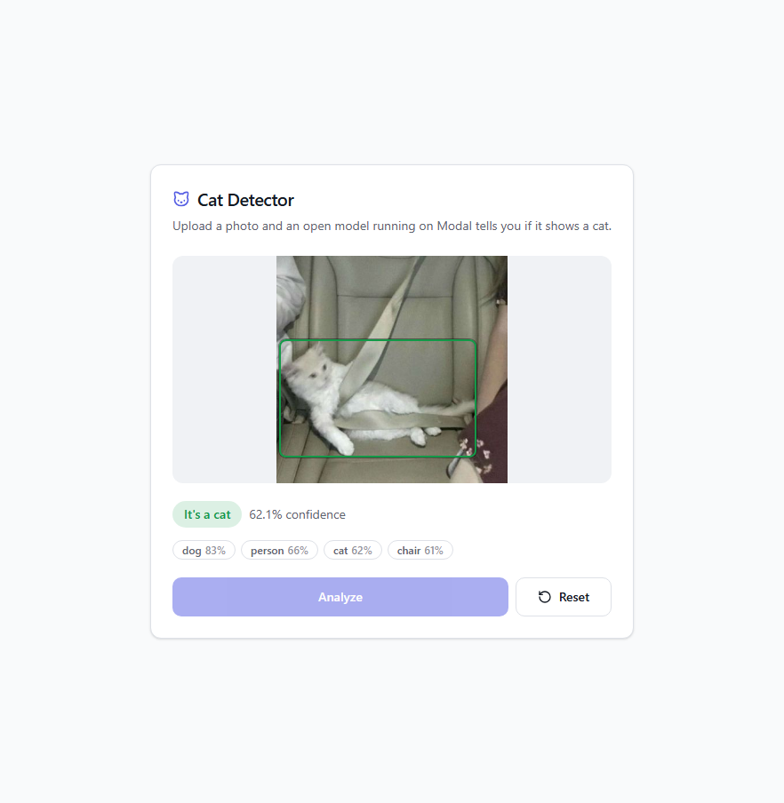
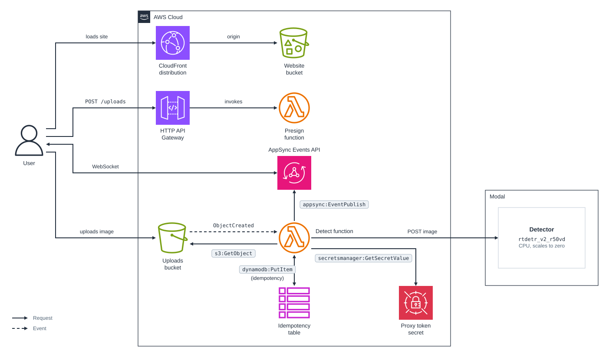

# cdk-modal-detect-labels

CDK app that detects whether an uploaded image contains a cat with an open model running on [Modal](https://modal.com), and pushes the result to the browser with AppSync Events.

### Related Apps

- [cdk/rekognition-detect-labels](../rekognition-detect-labels) - Detects the cat with Amazon Rekognition instead of an open model on Modal.

## Prerequisites

- **_AWS:_**
  - Must have authenticated with [Default Credentials](https://docs.aws.amazon.com/cdk/v2/guide/cli.html#cli_auth) in your local environment.
  - Must have completed the [CDK bootstrapping](https://docs.aws.amazon.com/cdk/v2/guide/bootstrapping.html) for the target AWS environment.
- **_Modal:_**
  - Must have a Modal account and have run `modal setup`.
  - Must have deployed the detector and set `MODAL_ENDPOINT_URL` in your local environment to the URL that `modal deploy` prints for `Detector.detect`:

    ```sh
    cd src/modal
    uv run modal deploy app.py
    export MODAL_ENDPOINT_URL=<DETECTOR_URL>
    ```

  - Must have created a Modal proxy token and stored it in AWS Secrets Manager as a secret named `aws-examples/modal-detect-labels/proxy-token` with the keys `key` and `secret`, in the Region you deploy to. This keeps the token out of the CloudFormation template:

    ```sh
    modal workspace proxy-tokens create --name detect-labels --json > token.json
    aws secretsmanager create-secret --name aws-examples/modal-detect-labels/proxy-token \
      --secret-string "$(jq '{key: .["Modal-Key"], secret: .["Modal-Secret"]}' token.json)"
    rm token.json
    ```

- **_mise:_**
  - [Install mise](https://mise.jdx.dev/installing-mise.html), which manages the required toolchain.

## Installation

```sh
mise install
pnpm install
```

## Deployment

```sh
pnpm run deploy
```

Deploying builds the React site in `src/website` first.

## Usage

1. Access the website by clicking the `<CLOUDFRONT_DISTRIBUTION_URL>` from the deployment outputs:

   ```sh
   Outputs:
   WebsiteDistributionUrl = <CLOUDFRONT_DISTRIBUTION_URL>
   ```

2. Drop a JPEG or PNG of up to 15 MB on the page and click `Analyze`:

   

## How it works

The flow matches [cdk/rekognition-detect-labels](../rekognition-detect-labels): the browser gets a presigned `POST` form, subscribes to the AppSync Events channel `/results/<uploadId>`, uploads the image to S3, and receives the result on the channel.

Only the detector differs. For each new object under `uploads/`, the detect function reads the image from S3 and posts its bytes to the Modal endpoint with the proxy token from Secrets Manager (read through Powertools Parameters, which caches it). `src/modal/app.py` runs [`PekingU/rtdetr_v2_r50vd`](https://huggingface.co/PekingU/rtdetr_v2_r50vd), an Apache-2.0 COCO object detector with 43M parameters, on 2 CPU cores. The weights are pinned to a commit and downloaded while the image builds. Objects below a score of 0.5 are dropped, and each `cat` becomes a bounding box.

- The endpoint has `requires_proxy_auth=True`, so Modal rejects any request without the token before it reaches the app.
- Unlike Rekognition, the model only knows the 80 COCO classes, and it can label a cat as a dog (the sample cat photo scores `dog` 83% and `cat` 62%).
- Containers stay up for 60 seconds after the last request and then scale to zero, with at most 3 running.

### Compared with Rekognition

| | Rekognition | Modal |
| --- | --- | --- |
| Price | $0.001 per image | $0.0000351 per second the container runs (2 cores, 4 GiB) |
| One image after idle | $0.001 | about $0.003: a 15 s start plus the 60 s idle window, both billed |
| Images in steady traffic | $0.001 | about $0.00006 at 1.7 s each |
| Labels | Thousands, with parents and aliases | 80 COCO classes |
| Latency | 1.5 to 2 s end to end | 1.7 s per request when warm; the first request after a deploy took 15 s, though one after 95 s idle took 2.1 s |

Modal prices are from [modal.com/pricing](https://modal.com/pricing) as of October 2026, and its Starter plan includes $30 of compute a month. Rekognition prices are from [its pricing page](https://aws.amazon.com/rekognition/pricing/).

## Cleanup

```sh
pnpm destroy
cd src/modal && uv run modal app stop detect-labels
```

`pnpm destroy` deletes every resource it created, including the buckets and their objects, and leaves the two log groups that Lambda creates for CDK's own helper functions, `/aws/lambda/cdk-modal-detect-labels-d-BucketNotificationsHandl-*` and `/aws/lambda/cdk-modal-detect-labels-d-CustomS3AutoDeleteObject-*`. It also leaves the Secrets Manager secret from the prerequisites, which you delete with `aws secretsmanager delete-secret --secret-id aws-examples/modal-detect-labels/proxy-token --force-delete-without-recovery`, and the Modal proxy token, which `modal workspace proxy-tokens delete` removes.

## Architecture Diagram


