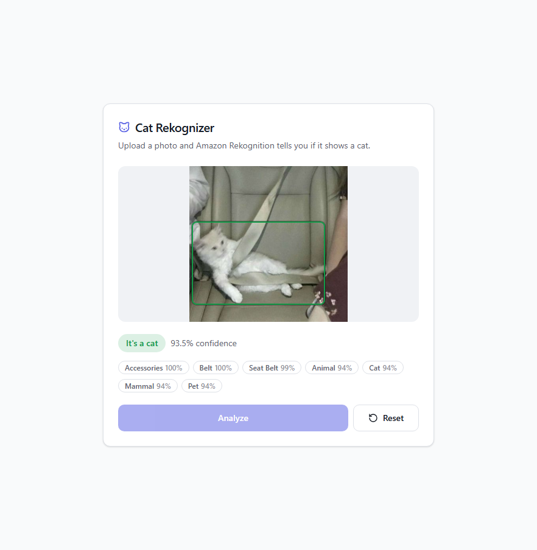
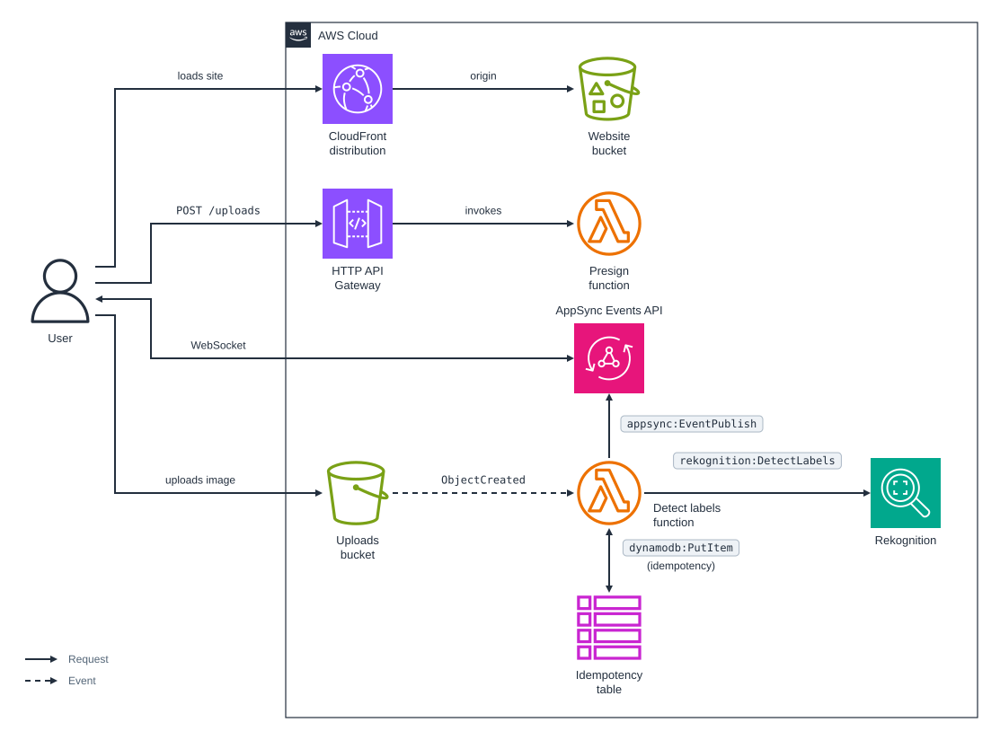

# cdk-rekognition-detect-labels

CDK app that detects whether an uploaded image contains a cat using Amazon Rekognition, and pushes the result back to the browser with AppSync Events.

### Related Apps

- [cdk/sagemaker-detect-labels](../sagemaker-detect-labels) - Detects the cat with an open model on a SageMaker Serverless Inference endpoint instead of Amazon Rekognition.

## Prerequisites

- **_AWS:_**
  - Must have authenticated with [Default Credentials](https://docs.aws.amazon.com/cdk/v2/guide/cli.html#cli_auth) in your local environment.
  - Must have completed the [CDK bootstrapping](https://docs.aws.amazon.com/cdk/v2/guide/bootstrapping.html) for the target AWS environment.
- **_mise:_**
  - [Install mise](https://mise.jdx.dev/installing-mise.html), which manages the required toolchain.

## Installation

```sh
mise install
pnpm install
```

## Deployment

```sh
pnpm run deploy
```

Deploying builds the React site in `src/website` first.

## Usage

1. Access the website by clicking the `<CLOUDFRONT_DISTRIBUTION_URL>` from the deployment outputs:

   ```sh
   Outputs:
   WebsiteDistributionUrl = <CLOUDFRONT_DISTRIBUTION_URL>
   ```

2. Drop a JPEG or PNG of up to 15 MB on the page and click `Analyze`. The page shows the upload progress, then the verdict, the detected labels, and a box around each cat:

   

## How it works

The browser asks the API for a presigned `POST` form for one `image/jpeg` or `image/png` object. The form's policy caps the size at 15 MB, which a presigned `PUT` URL cannot do, and the key is `uploads/<uploadId>`. Before uploading, the browser subscribes to the AppSync Events channel `/results/<uploadId>` with a subscribe-only API key.

S3 invokes the detect function for each new object under `uploads/`. The function calls `DetectLabels` with a minimum confidence of 75, takes the cat's bounding boxes from the `Cat` label, and publishes the result to the channel with its IAM role. The browser draws it as soon as it arrives.

- The channel handler only lets a client subscribe to an exact `/results/<uploadId>`, never to a wildcard, so the public API key cannot read other uploads' results. The key expires after 30 days; redeploy to issue a new one.
- Results are cached by the image's ETag for a day, so uploading the same image again skips Rekognition.
- A file that is not a readable JPEG or PNG is published as `unsupported`, instead of failing and being retried.
- Events that still fail after one retry go to the `detect-labels-failures` queue.
- Uploads expire after a day, and the API allows 5 requests per second.

## Cleanup

```sh
pnpm destroy
```

This deletes every resource, including the buckets and their objects. It leaves the two log groups that Lambda creates for CDK's own helper functions, `/aws/lambda/cdk-rekognition-detect-la-BucketNotificationsHandl-*` and `/aws/lambda/cdk-rekognition-detect-la-CustomS3AutoDeleteObject-*`, because they are not part of the stack.

## Architecture Diagram


