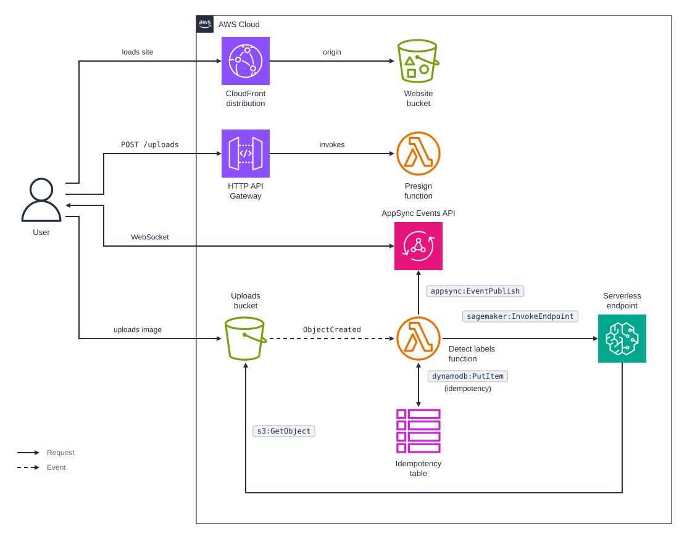

# cdk-sagemaker-detect-labels

CDK app that detects whether an uploaded image contains a cat with an open model on a SageMaker Serverless Inference endpoint, and pushes the result back to the browser with AppSync Events.

### Related Apps

- [cdk/rekognition-detect-labels](../rekognition-detect-labels) - Detects the cat with Amazon Rekognition instead of an open model on SageMaker.

## Prerequisites

- **_AWS:_**
  - Must have authenticated with [Default Credentials](https://docs.aws.amazon.com/cdk/v2/guide/cli.html#cli_auth) in your local environment.
  - Must have completed the [CDK bootstrapping](https://docs.aws.amazon.com/cdk/v2/guide/bootstrapping.html) for the target AWS environment.
  - Must deploy to a Region that offers [Serverless Inference](https://docs.aws.amazon.com/sagemaker/latest/dg/serverless-endpoints.html).
- **_Docker:_**
  - Must be running, to build the model's container image.
- **_mise:_**
  - [Install mise](https://mise.jdx.dev/installing-mise.html), which manages the required toolchain.

## Installation

```sh
mise install
pnpm install
```

## Deployment

```sh
pnpm run deploy
```

Deploying builds the React site in `src/website` and the model image in `src/model`, and creating the endpoint takes about 8 minutes. The script sets `BUILDX_NO_DEFAULT_ATTESTATIONS=1`, because SageMaker only accepts images with Docker v2 manifests, which BuildKit can't produce while it adds its default attestations; deploy with the script rather than with `cdk deploy`.

## Usage

1. Access the website by clicking the `<CLOUDFRONT_DISTRIBUTION_URL>` from the deployment outputs:

   ```sh
   Outputs:
   WebsiteDistributionUrl = <CLOUDFRONT_DISTRIBUTION_URL>
   ```

2. Drop a JPEG or PNG of up to 15 MB on the page and click `Analyze`:

   

## How it works

The flow matches [cdk/rekognition-detect-labels](../rekognition-detect-labels): the browser gets a presigned `POST` form, subscribes to the AppSync Events channel `/results/<uploadId>`, uploads the image to S3, and receives the result on the channel.

Only the detector differs. For each new object under `uploads/`, the detect function invokes a SageMaker Serverless Inference endpoint with the object's bucket and key, and the model container reads the image from S3 itself: serverless endpoints accept at most 4 MB per request, and uploads can be 15 MB.

- **Model:** [`ustc-community/dfine-large-coco`](https://huggingface.co/ustc-community/dfine-large-coco), D-FINE-L, an Apache-2.0 COCO object detector with 31M parameters. Its weights are pinned to a commit and baked into the image, so a container downloads nothing when it starts. Objects below a score of 0.5 are dropped, and each `cat` gets a bounding box.
- **Container:** `src/model` is a uv project with the CPU build of PyTorch and Transformers, and `serve.py` answers SageMaker's `/ping` and `/invocations` on port 8080. The image is about 0.5 GB.
- **Endpoint:** 6 GB of memory, the most Serverless Inference offers, which also gives the most vCPUs, and at most 5 concurrent requests. It scales to zero when idle, so the first request after a while waits for a new container.
- **Permissions:** the endpoint's role can pull the image, read `uploads/*`, and write to its own log group, which the stack creates so that it is deleted with the stack.

Unlike Rekognition, the model only knows the 80 COCO classes. Like Rekognition, it calls a lynx a cat.

### Compared with Rekognition

| | Rekognition | SageMaker Serverless |
| --- | --- | --- |
| Price in `eu-central-1` | $0.001 per image | $0.00012 per second of inference at 6 GB, plus $0.016 per GB of payload |
| Free tier | 1,000 images a month for 12 months | 150,000 seconds a month for the first 2 months |
| Cost of one warm image | $0.001 | about $0.0001, for 0.75 to 1 s of model time |
| Latency | 1.5 to 2 s end to end | 1.6 to 3 s end to end when warm; 16 s for the first request after the endpoint was idle |
| Labels | Thousands, with parents and aliases | 80 COCO classes |

Prices are from the [Rekognition](https://aws.amazon.com/rekognition/pricing/) and [SageMaker AI](https://aws.amazon.com/sagemaker/ai/pricing/) pricing pages as of October 2026.

## Cleanup

```sh
pnpm destroy
```

This deletes every resource, including the buckets and their objects, the endpoint, and its log group. It leaves the two log groups that Lambda creates for CDK's own helper functions, `/aws/lambda/cdk-sagemaker-detect-labe-BucketNotificationsHandl-*` and `/aws/lambda/cdk-sagemaker-detect-labe-CustomS3AutoDeleteObject-*`, and the model image in the CDK bootstrap's container assets repository.

## Architecture Diagram


