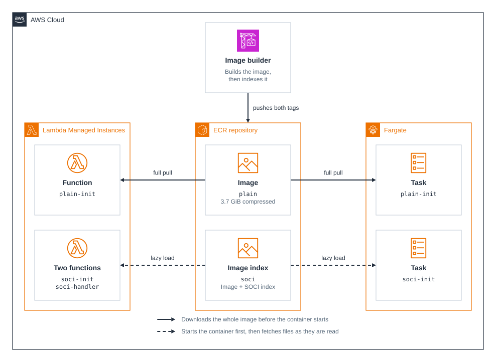

# cdk-soci-lazy-loading

CDK app that measures [Seekable OCI (SOCI)](https://github.com/awslabs/soci-snapshotter) lazy loading on two compute services, [Lambda Managed Instances](https://docs.aws.amazon.com/lambda/latest/dg/lambda-managed-instances-seekable-oci.html) and [Fargate](https://docs.aws.amazon.com/AmazonECS/latest/developerguide/fargate-tasks-services.html). On Lambda, SOCI is only available on Managed Instances.

SOCI starts a container before its image has been downloaded and fetches files as they are read. The app pushes one 3.7 GiB image to Amazon ECR under two tags, with and without a SOCI index, runs it on both services, and reports where the time goes. Both tags hold the same layers, so the index is the only difference.

## Prerequisites

- **_AWS:_**
  - Must have authenticated with [Default Credentials](https://docs.aws.amazon.com/cdk/v2/guide/cli.html#cli-auth) in your local environment. Synthesizing also needs them, because the app looks up the default VPC.
  - Must have completed the [CDK bootstrapping](https://docs.aws.amazon.com/cdk/v2/guide/bootstrapping.html) for the target AWS environment.
  - The account needs a default VPC in `eu-central-1`, where the app is pinned, and enough EC2 quota for 16 `c7g.xlarge` instances (64 vCPUs).
- **_mise:_**
  - [Install mise](https://mise.jdx.dev/installing-mise.html), which manages the required toolchain.

## Installation

```sh
mise install
pnpm install
```

## Deployment

```sh
pnpm run deploy
```

This takes about 10 minutes. It deploys the image stack, builds and indexes the image in CodeBuild, then deploys the compute stack, which needs both tags to exist.

The functions are deployed deactivated, but Lambda still starts three execution environments per function on the first publish, so about twelve instances run for a few minutes during the deployment. They terminate on their own afterwards.

## Usage

Run the benchmark, which takes about 14 minutes for the default of three runs:

```sh
pnpm measure
```

Each run is a cold start with an empty image cache and is printed as a JSON line. The summary at the end shows the median run of each variant. See [Comparison](#comparison) for results and what each phase means. The script deactivates the functions again when it finishes, so no instances stay up.

To confirm that the `soci` tag holds a SOCI index, while the stacks are deployed:

```sh
aws ecr batch-get-image --region eu-central-1 \
  --repository-name soci-lazy-loading --image-ids imageTag=soci \
  --query 'images[0].imageManifest' --output text |
  jq '.manifests[].artifactType'
```

## Cleanup

```sh
pnpm destroy
```

This deletes both stacks, including the ECR repository with its images and every log group. Only the image source and templates that CDK uploaded to its bootstrap bucket remain.

## Architecture Diagram



## Application Details

### Variants

Every variant runs the same image with 2 vCPUs and 4 GiB of memory on `arm64`. The workload imports PyTorch and reads a 256 MiB weights file. A further 3 GiB file in the image is never read, standing in for the content a large image carries that a given run doesn't need.

| Variant         | Tag     | Loads the workload    | Runs on      |
| --------------- | ------- | --------------------- | ------------ |
| `plain-init`    | `plain` | During initialization | LMI, Fargate |
| `soci-init`     | `soci`  | During initialization | LMI, Fargate |
| `plain-handler` | `plain` | In the first request  | LMI          |
| `soci-handler`  | `soci`  | In the first request  | LMI          |

A Fargate task runs the workload once and exits, so it has no later request to defer the load to.

### Building the index

`src/stacks/image-stack.ts` holds the build steps. The index is built with `nerdctl image convert --soci`, which produces the SOCI Index Manifest v2 that both services require, and the result is an image index with exactly two entries: the image and its SOCI index. Three details matter:

- The image is built with `--provenance=false`, because Lambda rejects the attestation manifests Docker adds by default.
- The index is built from containerd's image store, not Docker's, so the image is pushed and then pulled again with `nerdctl`.
- The pull uses `--unpack=false`, because indexing only needs the compressed layers and overlayfs can't unpack them on a CodeBuild container's disk.

### Enabling SOCI

Neither service has a setting for it. A function or task definition uses SOCI when its image URI points at the indexed tag. A function binds to the image when it's created, so rerunning `pnpm build-image` doesn't change deployed functions.

Fargate reports which snapshotter it used in the task metadata, and `pnpm measure` fails if that isn't the expected one. Lambda has no equivalent signal, so on Managed Instances the evidence for lazy loading is that an environment using a 3.7 GiB image is created in 10 seconds.

### Measuring

- **Fargate:** each run starts a new task. Timings come from the task's `createdAt` and `pullStartedAt` fields, plus the time the workload reports when its first request returns.
- **Lambda Managed Instances:** each run deactivates the function, waits for its instances to terminate, and activates it again. Timings come from the capacity provider's system logs, which are Lambda's own timestamps, plus the time the workload reports. Each variant has its own capacity provider, so none can reuse layers another one pulled.

The workload's clock and the services' timestamps are server-side, so the client polling for the first response doesn't add to them.

Managed instances are hidden from the default EC2 listing, so the script finds them with `IncludeManagedResources`.

## Comparison

Measured on 2026-11-08 in `eu-central-1`, with five cold starts per variant.



Each bar is the run with the median `ready` time, so its phases add up to it. The phases follow each other in the order shown:

- **Platform:** Fargate provisioning the task, or Lambda launching an instance and scheduling the execution environment.
- **Image:** from fetching the image to the workload starting. On Fargate this includes unpacking the layers, which happens after the pull Fargate reports.
- **Load:** importing PyTorch and reading the weights. With SOCI, this is when the files the workload reads are downloaded.
- **Waiting:** Lambda only, until the function is marked active and the first invoke reaches it.

| Service        | Variant         | Platform | Image | Load | Waiting | `ready` | Range       |
| -------------- | --------------- | -------: | ----: | ---: | ------: | ------: | ----------- |
| ECS on Fargate | `plain-init`    |     10.3 |  69.7 |  1.2 |       - |    81.2 | 80.6-83.3   |
| ECS on Fargate | `soci-init`     |      9.9 |   3.7 |  9.6 |       - |    23.2 | 23.0-25.9   |
| LMI            | `plain-init`    |     40.0 |  65.3 |  2.0 |    14.2 |   121.5 | 100.8-123.4 |
| LMI            | `soci-init`     |     40.4 |   9.8 | 18.9 |    12.5 |    81.6 | 80.9-82.9   |
| LMI            | `plain-handler` |     40.0 |  66.7 |  1.1 |    14.9 |   122.7 | 122.1-124.5 |
| LMI            | `soci-handler`  |     40.0 |  10.2 | 18.8 |    11.4 |    80.5 | 79.6-81.2   |

What the numbers show:

- **SOCI moves work instead of removing it.** The image phase drops from 70 to 4 seconds on Fargate and from 65 to 10 on Lambda, while load grows from 1 or 2 seconds to 10 on Fargate and 19 on Lambda, because that's when the files arrive. The net gain comes from the 3 GiB the workload never reads.
- **Fargate passes the whole saving on.** The task is ready 58 seconds sooner, 72% faster.
- **Lambda rounds the saving to 20-second steps.** Lambda starts creating the execution environment and marks the function active only on 20-second ticks after activation: in every run the function went active at 60, 80, 100, or 120 seconds, and in all but one, environment creation started at 40 seconds. SOCI shortens environment creation by 39 seconds for `soci-init`, which skips two ticks, so the function is ready 40 seconds sooner, 33% faster. Platform and waiting take the same time with either image. The `plain-init` run that was ready at 100.8 seconds had its environment created a tick early.
- **Loading in the handler doesn't change when the workload is ready.** Each handler variant is ready within about a second of its init variant. `soci-handler` goes active a tick sooner than `soci-init`, then spends 19 seconds loading in its first request. Timing environment creation alone, it looks 85% faster than `plain-handler`, so a figure such as [AWS's "up to 70%"](https://aws.amazon.com/about-aws/whats-new/2026/10/aws-lambda-seekable-oci-soci/) depends on what is timed.

The image is a best case for SOCI: 3 GiB of incompressible data that no run reads, which a plain pull pays for in full. The less of an image a workload leaves unread, the smaller the gain. The numbers don't cover scaling out onto an instance that already holds the image, or files first read long after startup. Load on Lambda is about twice that on Fargate with the same vCPUs and memory, and the benchmark doesn't isolate why. One documented difference is that Fargate keeps downloading the image in the background, while Lambda only fetches what's read.
