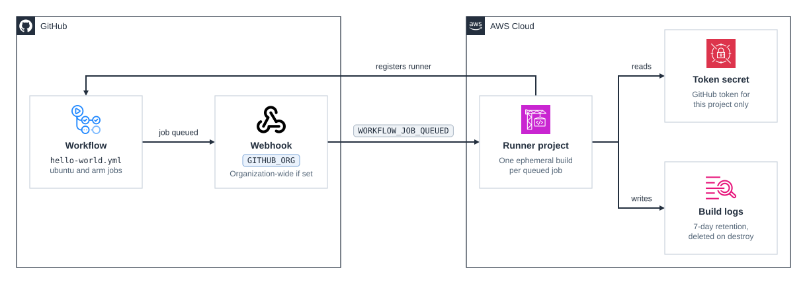

# cdktn-codebuild-gha-runners

CDKTN app that deploys a GitHub repository with a sample workflow, along with a webhook that triggers [CodeBuild-hosted GitHub Actions runners](https://docs.aws.amazon.com/codebuild/latest/userguide/action-runner.html) when workflow jobs are queued. The webhook covers the repository, or every repository in an organization.

## Prerequisites

- **_AWS:_**
  - Must have authenticated with [Default Credentials](https://registry.terraform.io/providers/hashicorp/aws/latest/docs#authentication-and-configuration) in your local environment.
- **_GitHub:_**
  - Must have set the `GITHUB_TOKEN` variable in your local environment to a classic personal access token with these scopes:
    - `repo`, which also lets CodeBuild create a repository webhook and register runners.
    - `workflow`, to commit the sample workflow.
    - `delete_repo`, without which `pnpm destroy` fails to delete the sample repository.
    - `admin:org_hook`, only with [`GITHUB_ORG`](#configuration), to create the organization webhook.
- **_mise:_**
  - [Install mise](https://mise.jdx.dev/installing-mise.html), which manages Node, pnpm, and OpenTofu.

## Configuration

By default the repository goes into the token owner's personal account, with a repository webhook. To create it in an organization you administer instead, with an organization webhook that sends queued jobs from every repository in it to the same CodeBuild project, set `GITHUB_ORG` when you deploy and destroy:

```sh
export GITHUB_ORG=<org-name>
```

## Installation

```sh
mise install
pnpm install
pnpm gen
```

`pnpm gen` generates the AWS and GitHub provider constructs into `.gen/`. Re-run it whenever a provider constraint in `cdktf.json` changes.

## Deployment

```sh
pnpm run deploy
```

## Usage

1. Open the `<GHA_WORKFLOW_URL>` from the deployment outputs:

   ```sh
   Outputs:
   GhaWorkflowUrl = <GHA_WORKFLOW_URL>
   ```

2. Click `Run workflow` ➜ `Run workflow`.

3. CodeBuild starts one build per job, and each build registers an ephemeral runner that runs the job and exits. The `ubuntu` job runs on the project's default environment, and the `arm` job overrides it from its `runs-on` label.

To run a job from your own workflow, target the project in its `runs-on` label, optionally followed by an [override](https://docs.aws.amazon.com/codebuild/latest/userguide/sample-github-action-runners-update-labels.html) for the image and instance size:

```yaml
runs-on: codebuild-gha-runners-${{ github.run_id }}-${{ github.run_attempt }}-arm-3.0-small
```

With an organization webhook, this works from any repository in the organization.

## Cleanup

```sh
pnpm destroy
```

## Architecture Diagram



## Application Details

- **Credential.** The project reads the GitHub token from its own Secrets Manager secret, set as the source's `auth`, rather than from an account-level CodeBuild source credential, which every other GitHub project in the account and Region would share and which `pnpm destroy` would delete for all of them. The token is a write-only value, so it stays out of the Terraform state.
- **Runner environment.** The project defaults to `aws/codebuild/standard:8.0`, Ubuntu 24.04 on x86, like GitHub's `ubuntu-latest`. That is the newest Ubuntu image CodeBuild offers, and it has no Arm Ubuntu image, so `arm-3.0` is Amazon Linux 2023.
