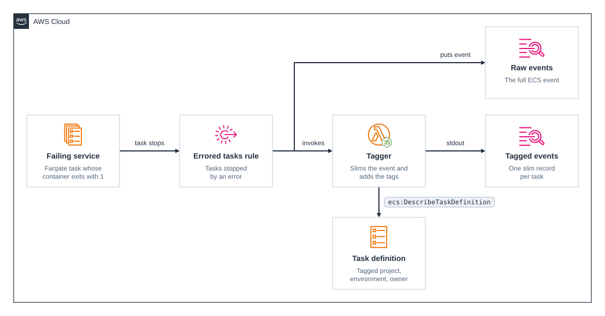

# cdktn-ecs-task-events

CDKTN app that captures [ECS task state change events](https://docs.aws.amazon.com/AmazonECS/latest/developerguide/ecs_task_events.html) for tasks that stopped because of an error, and sends each one both to a CloudWatch Logs log group as is and to a Lambda function that logs a slim record with the task definition's tags.

A Fargate service whose container exits with code 1 produces the events, so there is something to see as soon as the stack is up.

## Prerequisites

- **_AWS:_**
  - Must have authenticated with [Default Credentials](https://registry.terraform.io/providers/hashicorp/aws/latest/docs#authentication-and-configuration) in your local environment.
  - Must have a default VPC in the Region you deploy to.
- **_mise:_**
  - [Install mise](https://mise.jdx.dev/installing-mise.html), which manages Node, pnpm, and OpenTofu.

## Installation

```sh
mise install
pnpm install
pnpm gen
```

`pnpm gen` generates the AWS and node-lambda-packager provider constructs into `.gen/`. Re-run it whenever a provider constraint in `cdktf.json` changes.

## Deployment

```sh
pnpm run deploy
```

## Usage

The service's first task fails within a minute of the deployment. Follow each log group to see what its target receives:

```sh
aws logs tail /aws/events/ecs-task-events --follow
aws logs tail /aws/lambda/ecs-task-events-tagger --follow
```

The first holds the full EventBridge event, with about 30 fields in `detail`. The second holds one record per task, such as:

```json
{
  "level": "INFO",
  "message": "ECS task stopped with an error",
  "service": "ecs-task-events-tagger",
  "ecs_cluster": "ecs-task-events",
  "ecs_service": "ecs-task-events-failing",
  "ecs_task_id": "27a89d8a9486485f9fe1f709aac1f7b2",
  "ecs_task_definition": "ecs-task-events-failing:1",
  "error_code": "EssentialContainerExited",
  "error_message": "Essential container in task exited",
  "exit_codes": { "app": 1 },
  "tags": { "owner": "someone", "project": "example", "environment": "dev" }
}
```

ECS keeps replacing the failed task, and waits longer between attempts the more of them fail, so events keep arriving, more slowly, until you destroy the stack.

## Cleanup

```sh
pnpm destroy
```

ECS keeps the task definition as an `INACTIVE` revision, which costs nothing.

## Architecture Diagram



## Application Details

- **Rule.** `ecs-task-events-errored` matches `ECS Task State Change` events for stopped tasks, in any cluster in the Region, when one of these holds:
  - The stop code is `EssentialContainerExited` and a container exited with a non-zero code.
  - The stop code is `TaskFailedToStart`.
  - The stopped reason contains one of the [stopped task error categories](https://docs.aws.amazon.com/AmazonECS/latest/developerguide/stopped-task-error-codes.html) followed by a colon, such as `CannotPullContainerError:`, `OutOfMemoryError:`, or `ResourceNotFoundException:`.
- **Raw events.** EventBridge writes each event to `/aws/events/ecs-task-events`. The resource policy that allows it is attached to that log group, so it doesn't use one of the 10 Region-wide CloudWatch Logs resource policies an account can have.
- **Tagger.** `ecs-task-events-tagger` is a Node.js 24 function on arm64, bundled from `src/functions/tagger` by the node-lambda-packager provider. It validates the event with the Powertools for AWS Lambda parser, against a Zod schema of the fields it reads that follows the `aws.ecs@ECSTaskStateChange` schema in the EventBridge schema registry, since Powertools has no ECS schema. It takes the error code from the error category in the stopped reason, which ECS sometimes puts after context such as the secret it failed to fetch, and from the stop code otherwise, and reads the task definition's tags with `ecs:DescribeTaskDefinition`, once per revision in each execution environment. A standalone task has no `ecs_service`. It logs through the Powertools logger, in JSON, to `/aws/lambda/ecs-task-events-tagger`.
- **Failing service.** `ecs-task-events-failing` runs `busybox` from Amazon ECR Public on Fargate arm64, with `false` as its command. The task pulls from a public registry and has no log driver, so it has no execution role, and it runs in the default VPC's public subnets with a public IP instead of behind a NAT gateway.
- Both log groups keep events for 7 days.
