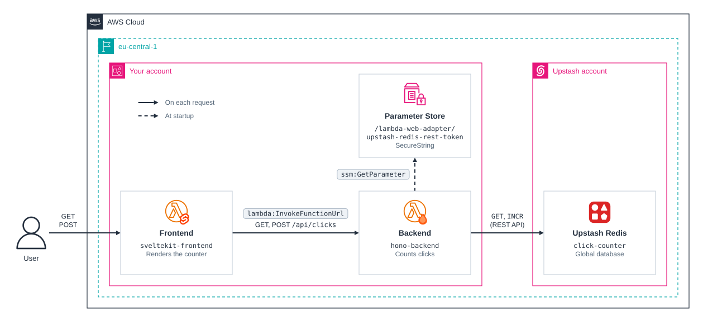

# cdktn-lambda-web-adapter

CDKTN app that runs a SvelteKit frontend and a Hono backend as Lambdaliths on AWS Lambda through the [AWS Lambda Web Adapter](https://github.com/awslabs/aws-lambda-web-adapter), with an Upstash Redis database for state.

### Related Apps

- [cdktn/lambda-web-function](../lambda-web-function) - Runs the same app as Lambda Web Functions, with DynamoDB for state.

Each app is an ordinary Node web server in an arm64 container image. The adapter runs as a Lambda extension inside the image, turns each invocation into an HTTP request to the server, and each function is exposed over a Lambda function URL.

The frontend's URL is public. The backend's URL uses `AWS_IAM` auth, so only the frontend can call it: the frontend signs each request with SigV4 using its execution role, and that role is the only one granted `lambda:InvokeFunctionUrl` and `lambda:InvokeFunction` on the backend function. Each function has its own execution role, and the Upstash REST token is kept in an SSM SecureString that only the backend's role can read.

## Prerequisites

- **_AWS:_**
  - Must have authenticated with [Default Credentials](https://registry.terraform.io/providers/hashicorp/aws/latest/docs#authentication-and-configuration) in your local environment.
  - The stack deploys to `eu-central-1`; change `region` in `src/stacks/my-stack.ts` to use another. The Upstash database's primary Region follows it.
- **_Upstash:_**
  - Must have set the `UPSTASH_EMAIL` and `UPSTASH_API_KEY` variables in your local environment.
- **_mise:_**
  - [Install mise](https://mise.jdx.dev/installing-mise.html), which manages Node, pnpm, and OpenTofu.
- **_Docker:_**
  - Must be [installed](https://docs.docker.com/get-docker/) in your system and running at deployment.
  - Must be able to build arm64 images. On an x86_64 machine that takes arm64 emulation, which Docker Desktop provides; elsewhere, `docker run --privileged --rm tonistiigi/binfmt --install arm64` registers it until the next reboot. Without it, the build fails with exit code 255 at `pnpm runtime set node 24 -g`.

## Installation

```sh
mise install
pnpm install
pnpm gen
```

`pnpm gen` generates the AWS, Docker, and Upstash provider constructs into `.gen/`. Re-run it whenever a provider constraint in `cdktf.json` changes.

The Hono backend in `src/functions/backend` and the SvelteKit frontend in `src/functions/frontend` are standalone pnpm projects with their own lockfiles, because each one is the build context of its Docker image. Biome lints them with the rest of the app, and `pnpm check` installs and typechecks them.

## Deployment

```sh
pnpm run deploy
```

Each image is rebuilt and pushed only when a file in its build context changes.

## Cleanup

```sh
pnpm destroy
```

## Application Details

Each function shares its name with the ECR repository that holds its image, and has its own `<name>-execution-role`. Each runs on arm64 with 1,769 MB of memory and a 10-second timeout, and its function URL invokes the function's latest image.

- `hono-backend` (function URL auth: `AWS_IAM`; a direct request without a signature gets `403 Forbidden`)
  - Environment variables:
    - `UPSTASH_REDIS_REST_URL` - REST endpoint of the `click-counter` database
    - `UPSTASH_REDIS_REST_TOKEN_PARAMETER` - Name of the SSM SecureString that holds the REST token, which the server reads once at startup
  - Endpoints:
    - `GET /` - Hello message
    - `GET /ping` - Returns `pong`; the Lambda Web Adapter's readiness check
    - `GET /api/clicks` - Returns the current click count, with the Redis call's duration in a `Server-Timing: redis;dur=…` header
    - `POST /api/clicks` - Increments the click count and returns it, with the same header
- `sveltekit-frontend` (function URL auth: `NONE`)
  - Environment variables:
    - `BACKEND_URL` - Function URL of `hono-backend`, declared and validated in `src/env.ts`
    - `AWS_ACCESS_KEY_ID`, `AWS_SECRET_ACCESS_KEY`, and `AWS_SESSION_TOKEN` - The execution role's credentials, which Lambda sets and `src/server/backend.ts` signs backend requests with
  - Endpoints:
    - `GET /` - Click counter, rendered on the server
    - `POST /` - Form action that increments the counter through the backend; it is the page's default action, because function URLs reject the `/` in a named action's `?/name` query string
    - `GET /ping` - Returns `pong`; the Lambda Web Adapter's readiness check

Both servers listen on port 3000, which the images pass to the adapter as `AWS_LWA_PORT`.

The page draws the request path from SvelteKit through Hono to Upstash Redis with each hop's time on the last request, split using the backend's `Server-Timing` header. It reloads its data when its tab is shown again or the browser regains focus, so counts made elsewhere appear. The Svelte, Hono, and Upstash Redis logos are copied unchanged from [sveltejs/branding](https://github.com/sveltejs/branding), [honojs/hono](https://github.com/honojs/hono), and [upstash/docs](https://github.com/upstash/docs) into `src/assets`.

The SecureString uses the AWS managed key `aws/ssm`, which any principal in the account can decrypt with, so the `ssm:GetParameter` grant is what limits who reads the token; a customer managed KMS key would add a second, key-level grant. Terraform state still holds the token, as it holds every secret Terraform manages, so keep the state private.

## Architecture Diagram



### Design Notes

- **Hono without the adapter.** Hono also runs on Lambda natively through `hono/aws-lambda`, which handles function URL, API Gateway, ALB, and VPC Lattice events with no adapter or HTTP server in the function. For a Hono-only service that is usually the leaner choice, with faster cold starts and an optional zip deployment, and the frontend could then call it with the Lambda Invoke API instead of a function URL. The Lambda Web Adapter earns its place with frameworks that lack an official Lambda adapter, such as SvelteKit, whose Node build runs here unchanged. Lambda Web Functions run that build unchanged too, without an adapter, but only on Node.js 24 and in the Regions that offer them.
- **Lambda-to-Lambda call.** The frontend calls the backend synchronously, so a request can meet two cold starts. Unlike with Web Functions, the frontend waits, and is billed, while the backend runs, though the hop is short: a p50 of about 15–17 ms. The split is the point of the example: two independently deployed web apps. In a product, the browser would usually call the API directly with user authentication, or the frontend would talk to Redis itself.

### Compared with Lambda Web Functions

Both examples run the same Node servers unchanged. This example wraps them in container images with the adapter as an extension; the Web Functions example runs them natively.

|                          | Lambda Web Adapter                                      | Lambda Web Functions                                                            |
| ------------------------ | ------------------------------------------------------- | ------------------------------------------------------------------------------- |
| Requests per environment | One at a time                                           | Many at once, up to `maxConcurrencyPerEnvironment` (64 by default, 128 at most) |
| Billing                  | Each request's duration, at the configured memory       | Active CPU time, plus memory for the environment's lifetime                     |
| Runtimes                 | Any, since the adapter runs inside your image           | Node.js 24 only                                                                 |
| Memory                   | Configurable, 128 MB to 10,240 MB                       | 2 GB                                                                            |
| Architecture             | arm64 or x86_64                                         | arm64                                                                           |
| Packaging                | Container image in ECR (`.zip` with a layer also works) | `.zip` in a versioned S3 bucket                                                 |
| Endpoint                 | Lambda function URL with `AWS_IAM` or `NONE` auth       | HTTPS endpoint with `IamAuth` or `ApplicationManaged` auth                      |
| Readiness                | An HTTP or TCP check the adapter polls                  | The port accepting connections                                                  |
| Response streaming       | Needs a streaming function URL and adapter setting      | Built in                                                                        |
| Extensions               | Supported; the adapter is one                           | None                                                                            |
| Regions                  | Every Region                                            | A subset, starting with five at launch                                          |

#### Measured Latency

| Frontend → backend hop | p50      | p95      |
| ---------------------- | -------- | -------- |
| Lambda Web Adapter     | 15–17 ms | 22–23 ms |
| Lambda Web Functions   | 6 ms     | 7–8 ms   |

The hop is the frontend's signed request to the backend, minus the database call, as the page shows it: SigV4 signing, the network inside the Region, and the platform's routing to the server. With the adapter, that routing goes through the function URL, the Lambda Invoke path, and the adapter's event-to-HTTP translation. The figures come from two runs of 300 sequential, warm page loads per example in `eu-central-1` on 2026-10-23, with the cold-start loads left out.
