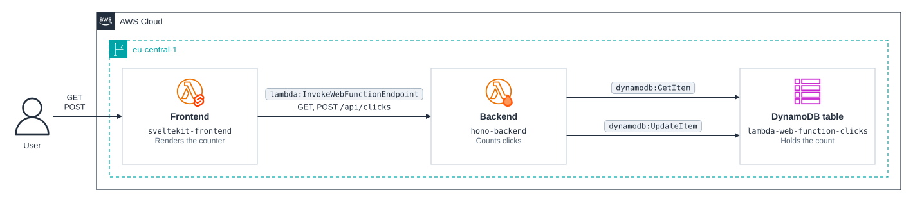

# cdktn-lambda-web-function

CDKTN app that runs a SvelteKit frontend and a Hono backend as [AWS Lambda Web Functions](https://docs.aws.amazon.com/lambda/latest/dg/web-functions.html), with a DynamoDB table for state.

### Related Apps

- [cdktn/lambda-web-adapter](../lambda-web-adapter) - Runs the same app through the Lambda Web Adapter in container images, with Upstash Redis for state.

Each app is an ordinary Node web server. Lambda starts it, waits for it to listen on the address in `AWS_LAMBDA_HTTP_ENDPOINT`, and sends it HTTP requests directly: there is no adapter, no event-to-HTTP translation, and no container image. Each function is a `.zip` package in a versioned S3 bucket, an immutable revision that pins that package's object version, and an HTTPS endpoint that routes to the revision.

The frontend's endpoint is public (`ApplicationManaged`). The backend's endpoint uses `IamAuth`, so only the frontend can call it: the frontend signs each request with SigV4 using its execution role, and that role is the only one granted `lambda:InvokeWebFunctionEndpoint` on the backend's endpoint. Each function has its own execution role, and only the backend's role may read and update the table.

## Prerequisites

- **_AWS:_**
  - Must have authenticated with [Default Credentials](https://registry.terraform.io/providers/hashicorp/aws/latest/docs#authentication-and-configuration) in your local environment.
  - Must deploy to a Region that offers Web Functions. The stack uses `eu-central-1`, which was not among the five launch Regions (`us-east-1`, `us-east-2`, `us-west-2`, `eu-west-1`, and `ap-northeast-1`) but served this example in October 2026; change `region` in `src/stacks/my-stack.ts` to use another.
- **_mise:_**
  - [Install mise](https://mise.jdx.dev/installing-mise.html), which manages Node, pnpm, and OpenTofu.

## Installation

```sh
mise install
pnpm install
pnpm gen
```

`pnpm gen` generates the AWS and AWS Cloud Control provider constructs into `.gen/`. Re-run it whenever a provider constraint in `cdktf.json` changes. Web Functions are only in the Cloud Control provider (`hashicorp/awscc` 1.106.0 and later) so far, so the stack uses it for the function, its revision, and its endpoint, and the AWS provider for everything else. The Cloud Control provider is large, and generating it takes about a minute.

The Hono backend in `src/functions/backend` and the SvelteKit frontend in `src/functions/frontend` are standalone pnpm projects with their own lockfiles. Synth installs and builds each one into its `dist/` directory, which becomes the function's package, much as `NodejsFunction` bundles in AWS CDK. Biome lints them with the rest of the app, and `pnpm check` installs and typechecks them.

## Deployment

```sh
pnpm run deploy
```

Each package is uploaded, and its function gets a new revision, only when the package's contents change. SvelteKit names each build after a hash of its source rather than the time, so an unchanged frontend builds a byte-identical package.

## Cleanup

```sh
pnpm destroy
```

## Application Details

Each function's code bucket is named `<name>-code-<suffix>`, and its execution role `<name>-web-execution-role`, so the roles don't clash with the `lambda-web-adapter` example's in the same account. Each endpoint is named `live`, is a `HomeRegion` endpoint, and sends all traffic to the function's latest revision.

- `hono-backend` (endpoint auth: `IamAuth`; Lambda rejects a direct request that isn't signed by an allowed principal)
  - Environment variables:
    - `TABLE_NAME` - `lambda-web-function-clicks`, whose `clicks` item holds the count
    - `AWS_LAMBDA_NODEJS_ENTRYPOINT` - `index.mjs`, the esbuild bundle, since Lambda loads `index.js` by default
  - Endpoints:
    - `GET /` - Hello message
    - `GET /api/clicks` - Returns the current click count (a strongly consistent read), with the DynamoDB call's duration in a `Server-Timing: dynamodb;dur=…` header
    - `POST /api/clicks` - Increments the click count with an atomic `ADD` and returns it, with the same header
- `sveltekit-frontend` (endpoint auth: `ApplicationManaged`)
  - Environment variables:
    - `BACKEND_URL` - Endpoint URL of `hono-backend`, declared and validated in `src/env.ts`
    - `AWS_ACCESS_KEY_ID`, `AWS_SECRET_ACCESS_KEY`, and `AWS_SESSION_TOKEN` - The execution role's credentials, which Lambda sets and `src/server/backend.ts` signs backend requests with
  - Endpoints:
    - `GET /` - Click counter, rendered on the server
    - `POST /` - Form action that increments the counter through the backend

adapter-node listens on `HOST` and `PORT`, so the frontend's package has a small `index.js` (`lambda/index.js`) that sets them from `AWS_LAMBDA_HTTP_ENDPOINT` and then starts the server.

Signed requests to an `IamAuth` endpoint must carry an `X-Amz-Content-SHA256` header, which Lambda takes as the payload hash. The frontend's requests have no body, so it sends `UNSIGNED-PAYLOAD`.

The page draws the request path from SvelteKit through Hono to DynamoDB with each hop's time on the last request, split using the backend's `Server-Timing` header. It reloads its data when its tab is shown again or the browser regains focus, so counts made elsewhere appear. The Svelte and Hono logos are copied unchanged from [sveltejs/branding](https://github.com/sveltejs/branding) and [honojs/hono](https://github.com/honojs/hono), and the DynamoDB icon from the [AWS Architecture Icons](https://aws.amazon.com/architecture/icons/), into `src/assets`.

## Architecture Diagram



### Design Notes

- **Revisions.** A revision is immutable, so every code or configuration change creates a new one. The stack creates it before deleting the old one, and the endpoint's revision weights point at it, so traffic always has a revision to go to. Canary splits between two revisions are possible with `revision_weights`, but a stack that replaces revisions on every change makes them awkward to hold.
- **Lambda-to-Lambda call.** The frontend calls the backend synchronously, so a request can meet two cold starts. Unlike with the adapter, waiting on the backend is cheap: it uses little of the frontend's CPU, which is what Web Functions bill, and the frontend's environment keeps serving other requests meanwhile. The split is the point of the example: two independently deployed web apps. In a product, the browser would usually call the API directly with user authentication, or the frontend would talk to DynamoDB itself.

### Compared with the Lambda Web Adapter

Both examples run the same Node servers unchanged. This example runs them natively as Web Functions; the adapter example wraps them in container images with the adapter as an extension.

|                          | Lambda Web Functions                                                            | Lambda Web Adapter                                      |
| ------------------------ | ------------------------------------------------------------------------------- | ------------------------------------------------------- |
| Requests per environment | Many at once, up to `maxConcurrencyPerEnvironment` (64 by default, 128 at most) | One at a time                                           |
| Billing                  | Active CPU time, plus memory for the environment's lifetime                     | Each request's duration, at the configured memory       |
| Runtimes                 | Node.js 24 only                                                                 | Any, since the adapter runs inside your image           |
| Memory                   | 2 GB                                                                            | Configurable, 128 MB to 10,240 MB                       |
| Architecture             | arm64                                                                           | arm64 or x86_64                                         |
| Packaging                | `.zip` in a versioned S3 bucket                                                 | Container image in ECR (`.zip` with a layer also works) |
| Endpoint                 | HTTPS endpoint with `IamAuth` or `ApplicationManaged` auth                      | Lambda function URL with `AWS_IAM` or `NONE` auth       |
| Readiness                | The port accepting connections                                                  | An HTTP or TCP check the adapter polls                  |
| Response streaming       | Built in                                                                        | Needs a streaming function URL and adapter setting      |
| Extensions               | None                                                                            | Supported; the adapter is one                           |
| Regions                  | A subset, starting with five at launch                                          | Every Region                                            |

#### Measured Latency

| Frontend → backend hop | p50      | p95      |
| ---------------------- | -------- | -------- |
| Lambda Web Functions   | 6 ms     | 7–8 ms   |
| Lambda Web Adapter     | 15–17 ms | 22–23 ms |

The hop is the frontend's signed request to the backend, minus the database call, as the page shows it: SigV4 signing, the network inside the Region, and the platform's routing to the server. With the adapter, that routing goes through the function URL, the Lambda Invoke path, and the adapter's event-to-HTTP translation. The figures come from two runs of 300 sequential, warm page loads per example in `eu-central-1` on 2026-10-23, with the cold-start loads left out.
